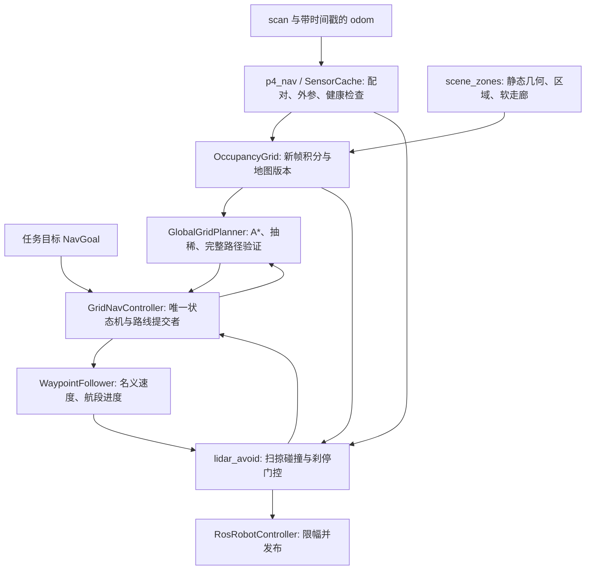

# DG-202606 P4 全图导航实现方案

日期：2026-09-06。代码仓：`D:\DG\supermarket_sorting`。

**文档性质：本轮独立规划交付，供后续实现 agent 使用；不表示本轮已实现或已通过仿真。** 本轮只新增本文，不修改导航源码、原任务文档或现有日志，不提交 git commit。后续获得实现任务后，按本文的阶段顺序推进。

背景先读 [AGENTS.md](./AGENTS.md)、[AGENT-BRIEF](./DG-202606-AGENT-BRIEF.md)，历史方案和失败记录见 [P4 原任务文档](./DG-202606-P4-导航与全局规划.md)。原文同时保留了旧局部方案、第一版全图方案和后续补丁，不能把所有段落同时当作现状。本文依据当前源码和截至 2026-09-06 的本地日志，明确新方案的取舍。

## 1. 核心结论

继续使用 **已知静态场景约束 + scan/odom 持久占用栅格 + 8 邻接 A* + 几何路径跟随 + 雷达安全门控**。沿用 `runtime/grid_planner.py` 中的核心类，不另起 Nav2、SLAM 或 DWA 系统。

全图导航的含义是：在同一坐标系中记录全部已观测障碍，每次从真实当前位置搜索到任务目标的完整路径。全图不等于开局知道所有箱子，也不等于只能沿预设黄线走。未观测区域允许参与全局搜索，执行速度和下一段实际运动必须受最新观测约束。

关键设计决定：

1. **启动即允许 A***，不等“确认障碍格达到 8 个”才切换全局模式。空地图也能规划。
2. **唯一的路线写入者是导航状态机**。跟随器只消费路径；雷达安全层只否决或缩小运动指令，不自行左右选边。
3. **先统一几何含义，再调整半径**。实体墙、机器人中心禁区、走廊偏好分开表达；不能靠清掉墙的膨胀或目标格来制造通路。
4. **重规划是明确的状态转换**。新障碍先停车，再更新图和搜索；无解进入有次数和时间上限的恢复，不能继续跟随未经检查的固定路线。
5. **保留本局地图**。货架到配送、配送返回货架、失败重试共享地图，目标变化只清路线和控制状态。
6. **先验证任意有效起点到目标的可执行性，再追求提速**。日志中的规划次数少、`detours=0`、进入拣货区，都不能单独代表成功。

## 2. 当前仓库实际状态与证据

| 项目 | 已核对的事实 | 对本方案的影响 |
| --- | --- | --- |
| 全图基础 | `grid_planner.py` 已有 `OccupancyGrid`、`GlobalGridPlanner`、`GridNavController`、`plan_to_waypoints` | 改造既有实现，不新建第二套规划器 |
| 9 月 5 日货架结果 | `shelf_20260905_075456.json`：到达，135.66 s 墙钟，`plan_id=50` | 历史成功不代表现版本已通过；“单 tick 位移”问题当前 `_note_progress` 已改为累计位移，仍需真实时间窗口和前进进度检查 |
| 9 月 5 日配送结果 | `delivery_20260905_075736.json`：停在 `(-1.472, 0.478)`，43 次规划，最后固定两点 fallback | 需要识别无解原因，以及证明所有回退路径仍可走 |
| 最新货架、配送结果 | `shelf_20260906_070722.json` 和 `delivery_20260906_071034.json` 均未到达，最终 `(1.066, 2.486)`、yaw `2.155`，持续 `hold`、`plan_id=1` | 增加越过近似禁区边界后的恢复；不能仅以“少重搜”验收 |
| 最新 hold 的代码路径 | `WaypointFollower._corridor_guard(global_mode=True)` 在 `in_north_racks` 内同时置零线速和角速；该点满足 `y >= 2.48` | 守卫命中必须产生有原因的事件，不能悄悄变成永久零输出 |
| 全图模式仍有局部决策 | `GridNavController._react()` 调用 `pick_detour_side`，产生 `face_turn`、`nudge` | `detours=0` 不能证明只有全局规划在决定方向 |
| 无解仍能发出不安全路线 | `fallback = self._fallback_route(...) or self._corridor_seed(...)`，后者绕过前者的碰撞检查 | 去掉无条件 `or` 兜底，所有可执行路径走同一验证入口 |
| 当前半径 | 静态 0.30 m、动态 0.22 m、放宽动态 0.18 m | 不沿用原文“当前统一 0.30 m”的说法，也不把 0.18 m 当作已证明安全的底盘尺寸 |
| 方向规则并不通用 | `early_southbound` 会将东通道 `(1.92, 0.0) -> (1.92, -0.1)` 判为非法 | 全图约束必须局限到真实墙角，不能全场禁止向南 |
| scan 更新 | `p4_nav.navigate()` 每轮拿缓存 scan，`GridNavController.integrate()` 每轮都积分 | 同一帧可能重复计票；运动后使用旧 scan 会把障碍画到错误位置 |
| 地图生命周期 | 每次 `navigate()` 都创建新的 controller 和 grid | 正式取送循环需要常驻导航对象 |

以上 hold 和东通道方向规则已用 `python -B` 的纯内存调用复核：清空障碍输入仍得到 `replan corridor -> hold`；同一位置在空栅格上直接调用 A* 能返回路线。这支持“控制守卫与地图不一致”的诊断，**不是对真实箱体布局或车辆物理状态的复现**。

本轮没有启动 Server、发底盘指令或重跑仿真。旧 `.log/.json` 没有原始 scan，不能从它们还原随机箱子的真实轮廓。

## 3. 任务范围与外部契约

### 3.1 约束

- 使用官方 Client/Server、ROS 2 Humble，评测离线；只依赖仓库和镜像已有能力。
- 通道障碍输入只用二维 `/slamware_ros_sdk_server_node/scan`，定位用 odom；不读取随机箱体的 Server 真值，不用视觉识别箱子。
- 所有底盘指令经 `RosRobotController.publish_velocity`。首轮使用既有限幅量级：线速不超过 0.35 m/s、角速不超过 0.65 rad/s。
- footprint 只按底盘计算，不把双臂展开宽度加入导航半径。上层在发起导航前完成已约定的升降、手臂携物姿态。
- 任务只保证 `id` 和 `kind`。商品在哪里由感知确定，不能从任务 JSON 猜商品坐标。
- 同一局失败后从当前物理状态恢复，不能自动重置 Server、布局或种子。另开测试局属于显式测试流程。
- 比赛预算为 420 s 仿真时间；当前脚本 150 s 是墙钟看门狗，两者分别记录。

### 3.2 导航目标与到达

定义 `NavGoal`，至少包含 `goal_id`、`kind`、`xy`、`final_yaw`、`xy_tolerance`、`yaw_tolerance`、`allowed_goal_region`、`deadline_sim`。

- `shelf_approach`：首轮兼容 `SHELF_APPROACH_XY` 和 `SHELF_FACE_YAW`。
- `delivery_approach`：使用 `DELIVERY_APPROACH_XY` 和 `DELIVERY_FACE_YAW`，并检查 `in_delivery_base`。
- `inspection_approach`：为 A-E 货架巡检提供通用目标接口。巡检层给出经标定的观察位置或感知生成的接近点，导航不生成商品真值；当前仓库没有可直接采用的五组完整接近点表，不能按等间距编造。

目标类型必须显式传入，不能再通过 `goal_xy[0] < 0` 区分货架与配送，因为西侧货架目标也可能是负 x。

默认位置误差不超过 0.12 m、朝向误差不超过 0.05 rad；位置、朝向、目标区域、底盘静止条件同时持续 0.30 s 仿真时间才报 `ARRIVED`。靠近任一航点、跨过终点投影、进入宽泛拣货区，都不算到达。低速静止阈值初值为线速 0.02 m/s、角速 0.05 rad/s，优先采用 odom 实测速度。

配送接近成功只表示底盘可以交给放置模块，不表示商品已被裁判判为成功配送。

### 3.3 同一局持续服务

`GridNavController` 所属导航会话在本局持续存在；`set_goal()` 只替换目标，清除当前路线、到达计时和恢复计数，保留地图。接入 `MissionOrchestrator` 时仍是“取一件 -> 立刻送 -> 下一件”。

地图标识使用 `run_prefix + frame_id + geometry_version`。只有明确新局、坐标系变化或定位跳变才能使地图失效；同局重试不清图。不默认从 `outputs/p4/last.json` 加载地图，该文件既没有完整占用数据，也没有足够的会话校验。首轮可保持地图仅在进程内存在，P4 单次 CLI 启动则重新观测建图。

## 4. 模块边界与数据流



| 文件 | 实现责任 | 不应承担的责任 |
| --- | --- | --- |
| `scene_zones.py` | 统一几何与区域来源；区分实体、中心禁区、软偏好 | 不维护观测到的随机箱体 |
| `ros_sensor_utils.py` | 保留消息 stamp、接收时间、scan 接收序号、短 odom 历史 | 不作路线决策 |
| `grid_planner.py::OccupancyGrid` | 纯 Python 地图、证据积分、占用和代价版本 | 不依赖 ROS、不发布速度 |
| `grid_planner.py::GlobalGridPlanner` | 搜索、起终点验证、路径验证、结构化失败原因 | 不偷偷改变目标、半径或清理地图 |
| `grid_planner.py::GridNavController` | 状态、重搜、恢复、路线原子提交、成功失败结果 | 不直接发布 Twist |
| `waypoint_nav.py` | 只读路径跟随，报告航段、进度、终点误差 | 全图模式不插点、不 rebase、不按西轨强行改线 |
| `lidar_avoid.py` | 最新雷达与地图的安全门控、速度上限、原因码 | 生产模式不 `pick_detour_side`、不替换角速度方向 |
| `p4_nav.py` | ROS 订阅、时钟、控制周期、调用编排、落日志 | 不再写第二份走廊或恢复逻辑 |

纯算法层建议固定以下数据契约，具体 dataclass 名称可随现有代码微调：

| 对象 | 必需内容 |
| --- | --- |
| `PoseSample` | `stamp_sim, received_wall, frame_id, x, y, yaw, linear_speed, angular_speed` |
| `ScanSample` | `scan_id, stamp_sim, received_wall, frame_id, ranges, angle_min, angle_increment, range_min, range_max, time_increment` |
| `MapUpdate` | `map_version, occupancy_version, changed_cells, newly_blocked_cells, accepted_scan_id` |
| `PlanRequest` | 当前真实 pose、NavGoal、地图快照版本、几何/footprint 版本、请求序号 |
| `PlanResult` | `status, failure_reason, path_xy, start_connector, accepted_goal, map_version, cost, min_clearance, expanded_nodes, search_ms` |
| `NavStepResult` | `linear, angular, state, reason, arrived, plan_id, progress_s, goal_error` |

`plan_id` 只在一条新的可执行路线提交时递增；另设 `plan_attempt_id` 记录搜索尝试。相同有效路线可以返回 `UNCHANGED`，失败和重复搜索不伪装成路线进展。

## 5. 几何、坐标系与地图定义

### 5.1 固定几何先做一次语义校准

现有常量包括导航经验阈值，不都是可直接膨胀的物理外形。例如 `NORTH_RACK_Y=2.48` 与 `SHELF_APPROACH_XY.y=2.475` 只差 0.005 m；若前者是物理货架表面，就不可能同时把后者当作半径 0.30 m 机器人的安全中心。隔墙顶端 1.90 到 2.48 的宽度只有 0.58 m，也容不下直径 0.60 m 的圆。**这首先是几何含义冲突，不能据此判断物理通道无路，也不能清膨胀硬开通道。**

实施阶段 S0 必须输出一份经核对的静态几何配置，每项标注 `source`、`kind`、坐标系和误差范围：

1. `physical_solids`：有官方固定场景定义或固定结构测量依据的墙、货架、配送桌投影、外墙。仅这些几何做底盘 Minkowski 膨胀；静态资料不能包含本局随机箱体或商品位置。
2. `center_forbidden`：已经针对底盘中心定义的禁止区域，不重复膨胀。`NORTH_RACK_Y`、`near_divider_nw_corner` 在校准前按历史行为阈值处理，不宣称是真实物体表面。
3. `preferred_corridors`：`WEST_LANE_Y`、`HUG_WEST_X`、`SOUTH_PEEL_Y` 和 `ROUTE_*` 形成的软代价带，不产生 free，也不覆盖障碍。
4. `NAV_BOUNDS`：现注释是导航搜索外包，不能自动等同物理外墙。搜索范围外一律不可规划；真实外墙另有实体几何时才据其做膨胀。

南缝禁止穿行用一个固定中心禁区表达，覆盖跨越隔墙南端的通道，**双向生效**；不禁止西走廊去配送点，也不禁止东走廊正常南行。西北角约束限于校准后的局部墙角，不使用“只要 x 大于 -0.32 就全图禁南行”的规则。

无法核定的几何不得通过放宽常量变成“已安全”。S0 的结果要明确哪些边界已经验证、哪些仍使目标不可用；这是一项具体实现前置工作，不留给调参时猜。

### 5.2 底盘与膨胀

第一版仍使用圆形底盘模型，便于安全原地转向和 2D A*。`R_body` 来自底盘碰撞模型在地面的包络；`margin_tracking` 来自跟随误差和定位误差，统一得到 `R_plan = R_body + margin_tracking`。静态实体和雷达箱体采用相同物理下限。

核定方法：从官方机器人碰撞模型取底盘/轮组的 collision 几何，按各 body/joint 的固定变换投到 base 平面，求以控制原点为圆心的外接半径；不使用渲染 mesh 的外观边缘代替碰撞体。用低速贴近固定墙的 scan/odom 对照检查外参与距离，再用直段/转角跟随的实测误差决定余量。只读取固定模型定义，不读取随机障碍布局；标定记录须带模型版本和测量条件。

0.30 m 作为旧方案的待校准起始参考，**不是本轮确认的真实底盘半径**。现有 0.22/0.18 m 也不构成测量依据。无解不能自动把半径降到 0.18 m；若圆形包络确实过于保守，另以实测矩形 footprint 与姿态相关碰撞检查评估，不在本轮假装“小圆也安全”。

栅格占用应计入格子面积，碰撞查询计算圆到占用格矩形的距离，或等价保守栅格化，不能只比较两格中心距离。额外舒适净空放在软代价中，不能同一物体硬膨胀两次。

### 5.3 坐标系与时间配对

默认全局规划坐标系与官方 odom 的世界平面一致，但启动时必须检查 `header.frame_id`、`child_frame_id` 以及静态地图的坐标定义。用固定场景资料/TF 确认 `T_world_odom`，不能仅把出生位看似接近就当作已验证。

每束雷达的二维变换为：

```text
p_world = T_world_odom * T_odom_base(t_scan) * T_base_laser * [r*cos(a), r*sin(a), 1]
a = angle_min + beam_index * angle_increment
```

`T_base_laser` 同时包含平移和偏航，来自已有 TF 工具或经核对的固定外参。没有 TF 但官方定义证实重合时可以显式配置单位变换，并记录来源；否则停在 `TF_UNAVAILABLE`，不静默猜零偏移。旋转和平移转换也必须用于安全层的雷达点，不能地图用一套、安全层用另一套。

保存约 2 s 的 odom 历史，按 scan stamp 插值位置和最短角差；启动默认匹配误差不超过 0.10 s 仿真时间，数据实测后再收紧。不能匹配的 scan 不积分。若 `time_increment` 有意义且整帧采样期间车体运动超过地图误差预算，按束插值；若官方 scan 是瞬时生成则按整帧 stamp，不伪造逐束时间。

新鲜度初值：scan 年龄不超过 0.30 s 仿真时间，odom 不超过 0.20 s；同时检查墙钟接收间隔，失联阈值取 `min(5.0, max(1.0, 3 * 最近有效消息墙钟周期中位数))` 秒，启动没有历史时为 1.0 s。任一超限立即置零并进入 `WAIT_SENSORS`，连续 8 s 墙钟未恢复返回 `SENSOR_TIMEOUT`。高速度下第 8 节的延迟制动约束仍可能要求更低速度。新 scan 必须覆盖候选运动方向的所需观测区域；全 NaN 或未经确认语义的全 inf 不构成健康、畅通输入。

### 5.4 栅格与图层

0.10 m 栅格，origin 和尺寸从 `NAV_BOUNDS` 得到，当前为 49 列、72 行，约 3528 格。向上取整形成的尾部半格仍按精确 `NAV_BOUNDS` 裁剪，不因数组存在就允许驶出边界。

分别保存：`static_solid`、`center_forbidden`、`observed_free`、`hit_score`、`confirmed_occupied`、`last_hit_sim`、`last_free_sim`、`free_streak`，再派生 footprint 碰撞层和净空软代价。静态几何不被射线擦除。

- `map_version`：接受新观测并使地图证据变化时递增。
- `occupancy_version`：硬占用掩码变化时递增，附带改变的格集合。
- `geometry_version`：几何/坐标系/footprint 配置变化时更新，使旧路径失效。

不要只比较“确认格总数是否增加”。一格新增、一格清除时总数不变，当前路径仍可能被切断。

## 6. 雷达建图与障碍记忆

### 6.1 每个新 scan 只积分一次

接收回调分配递增 `scan_id`，同时保留原始 stamp。新 `scan_id` 解决缓存重复读取；同 stamp 的重复消息去重，不能算多个独立命中。stamp 持续不推进必须报告时钟/传感器问题。20 Hz 控制可重复使用最新 scan 做时效范围内的刹停检查，但不能重复给地图加分。

积分上限初值 10 Hz，新消息可以合并丢弃中间帧；丢弃的帧不计确认次数。地图确认取决于实际接受的新观测，不取决于 `step()` 调用次数。

### 6.2 射线规则

1. 按消息 `range_min/range_max` 判断量程；`NaN`、负值、无效下限值不更新 free，也不作为畅通证据。
2. 有限命中 `range_min <= r < range_max - epsilon`：从真实雷达原点到命中格之前的格记 free，端点记 hit；`epsilon` 初值 0.01 m 并按发布器量化方式核对。
3. 量程上限或 `+inf` 只有在官方发布器语义确认为“未命中”时才沿射线清 free，不画端点。否则视为未知，不能把整张坏 scan 当开阔环境。
4. 观测使用 supercover 栅格遍历并裁到精确边界；遇已知实体静态墙停止，不能把墙后涂 free。观测射线穿过中心禁区或规划膨胀层并不等于穿实体，不应提前截断。
5. 一帧每格 hit/free 最多计一次，hit 优先于 free。自回波只按经校准的底盘内部区域/传感器遮挡掩码排除；不能泛化为“0.25 m 内所有障碍都忽略”。安全层仍处理掩码之外的有效近距离障碍。
6. 与已知静态墙面吻合的端点归静态证据，避免重复膨胀；判定依据是物理表面和误差容差，不能依据“离已膨胀墙很近”屏蔽真实贴墙箱子。

### 6.3 确认与清除的确定规则

- 初始 `score=0`，独立帧命中 `+2`、空闲射线 `-1`，截断到 `[0,5]`。至少两个不同 scan 命中且 `score >= 3` 时置 `confirmed_occupied=true`。
- 未确认端点保留为临时风险；最新近障碍进入安全层立即生效，不等待“两帧确认”后才刹车。
- 未确认孤立点 5 s 仿真时间无新命中可清除，但没有新 free 证据则回到 unknown。
- 已确认障碍在遮挡、转身或长时间未观测时保留。只有端点所在格被至少 3 帧连续的新 free 射线穿过，且 score 已降到 0，才能清除；任何新 hit 重置 free streak。
- free 证据 10 s 仿真时间未刷新后，执行层不再把它当近期已确认通路；全局层可退回 unknown 代价。障碍确认不随 free 的老化一起消失。
- 不逐帧把机器人脚下整圆清成 free；正确做法是拒绝自回波。如果仍产生起点冲突，输出原因并进入起点检查，而不是擦掉周围真实箱体。

这些时间和次数是实现初值，需在有噪声和实际 scan 频率下验收。地图记忆解决“两箱不能同时记住”的问题，多帧 free 证据则防止偶发误点永久封路。

## 7. 全局搜索、起终点与路径生成

### 7.1 搜索规则

采用现有 `heapq` A*，8 邻接，斜走时两侧正交相邻格都必须可通行。用同一个几何查询检查边，不在搜索后再补一套不同含义的墙角规则。

第一版搜索状态只用 `(col,row)`，**移除依赖父方向的转向罚分**。现实现按格合并状态又收转向费用，不能完整表示不同到达方向；第一版用净空代价与碰撞检查后的抽稀减少折线即可，不为此扩大状态空间。

代价统一按米计：

```text
edge_cost = step_length_m * (base_cost + clearance_cost + corridor_cost)
base_cost = 1.0 [近期 free] 或 2.5 [unknown]
clearance_cost = max(0, 1 - extra_clearance_m / 0.20)
corridor_cost = min(1.0, 0.35 * distance_to_preferred_corridor_m)
h = resolution * ((max(dx,dy) - min(dx,dy)) + sqrt(2)*min(dx,dy))
```

所有附加项非负，启发式与步长使用相同单位。`extra_clearance` 是扣除底盘安全包络之后的额外净空。首选走廊由显式目标类别和当前起点所属区域确定，货架返回时必须包含西走廊北行，不把出生点当每条路线的起点。

unknown 可用于完整路径搜索；下一段运动只有在最新雷达确认的可刹停空间内执行。走到可见边界前先减速/停住获得新观测，由此逐步探索，而不是要求开局整个目标方向都观测为 free。

### 7.2 起点不能被悄悄搬走

先验证真实起点，再决定是否可以接入栅格链：

| 起点状态 | 行为 |
| --- | --- |
| 正常可通行 | 保留真实坐标，验证它到首个格中心的连接段 |
| 仅因舒适余量或网格边缘而受限 | 搜索 0.40 m 内候选，但必须满足真实欧氏距离上限和完整连接段验证，不能跨墙选最近 free |
| 落入已经验证的中心禁区，实体 footprint 尚未碰撞 | 仅恢复状态可构造离开该区域的短路径，要求禁区侵入量单调减小、物理扫掠安全；不允许正常导航向禁区更深处走 |
| 与实体墙或确认障碍的物理包络相交，或定位不可信 | `START_IN_COLLISION` / `LOCALIZATION_INVALID`；停车诊断，不能凭空投影到另一侧再宣布有路径 |

任何因余量而放宽的起点连接都只作用于这条短连接，不能改变整张地图半径。若不能证明连接安全，则返回结构化失败。

### 7.3 终点必须满足原任务意图

精确目标可走时，追加真实终点前再次检查最后一段。目标被箱体占用时，只能在 `allowed_goal_region` 与原目标容差的交集中选择候选，且报告 `accepted_goal`；对抓取目标，上层未提供可替代区域时不作替换。

0.80 m 内任意 free 格不一定是可抓取或可配送的位置。禁止先搜索到替代格，再无条件把被占用的原目标追加回路径；也禁止把目标格强制清空。候选为空返回 `GOAL_BLOCKED`，由上层安排新的接近点。

### 7.4 抽稀与统一验证

先保存完整 A* 格链，再做沿已验证线段的视线抽稀。只有当连接线通过完整碰撞检查才跳过中间格；急转角即使间距不足 0.25 m 也必须保留，不能为了航点间距好看而切角。

沿长直段约每 0.45 m 采样，短末段保留。最终验证对象必须是：**真实起点 -> 起点连接 -> 抽稀后的所有线段 -> 最终接近点**。验证全部静态、动态、中心禁区、边界和目标约束，不仅检查前方 1.5 m。

跟随器跳过近航点时也使用相同验证规则，不能在最后一次验证后靠 `_set_route()` 裁点、`_skip_near_waypoints()` 或 `rebase_west_south()` 再改出一条未验证的线。

`PlanResult.failure_reason` 至少区分：`START_OUTSIDE_MAP`、`START_IN_COLLISION`、`START_CONNECTOR_BLOCKED`、`GOAL_BLOCKED`、`NO_CONNECTIVITY`、`PATH_VALIDATION_FAILED`、`SEARCH_BUDGET_EXCEEDED`、`MAP_INCONSISTENT`。单一 `None` 不足以驱动恢复，1.4 ms 的失败也不能直接解释为搜索性能好。

## 8. 跟随与安全门控

### 8.1 跟随器不再拥有路线策略

沿用 `WaypointFollower` 的朝向控制和终点对齐，但全图模式下关闭 `insert_ahead`、`rebase_west_south`、`_cuts_back_east` 等走廊路线重写行为。旧局部模式 API 可以保留供兼容测试，生产调用链不得进入它们。

首个航段固定使用提交路径时的真实起点，后续航段使用前后路径点。不能每 tick 都把当前 pose 当作首段起点，否则第一段横向误差永远为零。进度 `progress_s` 用活动航段附近的弧长投影计算，限制投影搜索范围，避免路径绕回时误跳到后面的近邻段。

直段按剩余距离、航向误差和允许速度行驶。急转角先减速到停，再转向下一段；第一版优先保留安全拐点，不用大 lookahead 提前切过黄线墙角。转弯允许边走边转的前提，是实际圆弧扫掠通过第 8.2 节的验证。

旧 `_corridor_guard` 中基于位置一刀切的零输出改为明确事件，例如 `CENTER_GUARD_VIOLATION`，交给状态机决定是否执行安全退出。正常跟随不自行逃离禁区，恢复也不能绕过物理碰撞检查。

### 8.2 规划净空与刹停距离分别计算

地图 footprint 处理“几何上能不能通过”，刹停处理“当前速度下能不能及时停下”。固定 `STOP_DIST=0.43` 不能覆盖所有速度，也不能代替侧面或后方检查。

使用最新 scan 转成底盘坐标的点，加地图中的已知占用，对候选 `(v,w)` 的差速运动圆弧做扫掠检查。路径采样平移间隔不大于半格；圆形 footprint 原地转动不扩大包络，但必须先确认当前整圈底盘空间安全。倒车检查后方，圆弧检查侧向，不仅使用正前 ±0.22 rad 的一个锥。

安全层把近期 free 射线覆盖之外的空间作为当前执行视野边界。因此 `d_free` 同时截断在首次碰撞或未观测边界，不能把“点云里没有端点”当作已观测 free。采样之间的运动也需覆盖：检查相邻采样中心的扫掠胶囊，或等价加入半步长误差包络，避免离散采样漏掉擦角。

令 `d_free` 为沿候选运动到首次 footprint 碰撞的可行距离，`v` 为 odom 实测速度与近期命令估计的保守值，则必须满足：

```text
d_free >= abs(v) * tau + v*v / (2*a_brake) + margin_stop
```

`tau` 包含 scan 年龄、控制延迟、地图/搜索可能的阻塞时间；`a_brake` 和控制响应由低速仿真测量。这里 `d_free` 已扣掉 footprint，不再把底盘半径重复加一遍。尚未完成制动标定时只使用低速配置，0.43 m 可作为原有正前保护参考，不能因此放开 4×/8×。

门控先取跟随器产生的名义指令，再按可行净空缩小 `(v,w)` 或置零；保持原有转向意图，不擅自换成“更空的一侧”。若调整会改变运动轨迹，重新检查调整后的轨迹；最简单可采用等比例缩放保持曲率，原地转向另行验证。雷达障碍挡住向前运动时，朝远离障碍方向的安全转动/倒车不应被同一个前向阈值错误禁止。

新命中未达到确认阈值时，安全层立即停车。规划重试使用这些真实新端点构成的临时阻塞层，避免持久图尚未确认就返回同一条迎面路径；临时层按新观测更新，不凭空把整片 unknown 或整条路线画成箱体。

所有分支统一经过门控和限幅，包括恢复、终点转向、替代观察点运动、倒车。丢 scan、定位异常、计算超时的输出都是 `(0,0)`，不允许恢复分支提前 return 绕过门控。

### 8.3 速度与时钟

正式初始配置保持约 0.30 m/s 巡航、0.55 rad/s 转向，并受现有限幅保护。之后只在制动距离、定位配对误差、控制周期均通过后提高上限。当前 `--speed-scale 4` 实际把速度上限提高到 1.20 m/s，**不是把仿真运行速度调成四倍**。

运动进度、恢复动作时长、障碍证据老化和 420 s 任务预算使用仿真时间；计算耗时、消息接收失联、ROS 回调卡住和脚本看门狗使用单调墙钟。优先使用已确认与 Server MuJoCo 时间一致的 `/clock`，否则使用验证过的消息 stamp，并明确时间起点。不能每次 `navigate()` 重置比赛已经消耗的时间。

`dt` 来自真实相邻仿真时间戳，不能把固定 `period=0.05` 当实际物理步长。仿真暂停时不累计停滞；墙钟看门狗仍能发现消息断流并发零速。仿真时钟回退或 odom 不连续时进入定位异常状态，使旧地图和路径失效，不能直接继续积分。

## 9. 导航状态机与重规划时序

### 9.1 状态及其唯一速度来源

| 状态 | 进入条件 | 输出与退出条件 |
| --- | --- | --- |
| `WAIT_SENSORS` | 启动、scan/odom/TF 缺失或不新鲜 | 零速；收到可配对的新数据才进入 `PLAN`，启动等候默认最多 8 s 墙钟 |
| `PLAN` | 启动、目标改变、失效路线需要替换 | 先实际发布零速，再搜索；有效结果原子提交后到 `FOLLOW`，失败到 `OBSERVE` 或相应终止状态 |
| `FOLLOW` | 有有效计划 | 跟随器提供名义指令，门控执行；命中失效条件到 `BRAKE_WAIT`；位置达标到 `ALIGN_GOAL` |
| `BRAKE_WAIT` | 新近障碍、路径失效、跟随异常 | 零速并锁存原因；刹停后收集新帧，满足重搜间隔再到 `PLAN`，期间不恢复旧直行命令 |
| `OBSERVE` | 地图证据不足或可恢复的搜索失败 | 原地等待至少 3 帧新 scan；必要时进入明确的 `RECOVER`；变化足以重试时到 `PLAN` |
| `RECOVER` | 第 10 节规定的一个有界动作 | 只执行该动作并统一门控，结束即停车回 `PLAN`；不能同时调用正常 follower |
| `ALIGN_GOAL` | 达到位置与目标区域条件 | 线速为零，安全地完成 final yaw；位置漂出容差则重新规划，全部到达条件满足后到 `ARRIVED` |
| `ARRIVED` | 全部到达条件稳定满足 | 零速，向上层报告成功；新目标启动下一次导航 |
| `BLOCKED` / `FAILED` / `TIMEOUT` | 恢复预算耗尽、不可恢复输入错误或期限到达 | 零速，返回结构化原因；上层可从当前状态重新给目标，本状态不隐式清图或重置场景 |

正常状态输出零速时必须有原因和退出条件，不能只报无限期 `hold`。`ALIGN_GOAL` 也有转向停滞检测，不能把所有“正在转向”都永久排除于失败检测之外。

### 9.2 控制循环

```text
每轮控制周期:
    接收消息，读取一个一致的传感器快照
    检查时钟、TF、odom 和 scan 新鲜度
    传感器异常 -> 立即发布零速，更新 WAIT_SENSORS/FAILED，结束本轮
    若 scan_id 尚未积分且可时间配对 -> 更新地图、临时障碍与版本
    根据状态、真实运动进度、改变的路径格产生事件
    若事件使路线失效 -> 锁存原因，先发布零速，再等待重搜
    若进入 PLAN 且到重搜时刻 -> 对地图快照搜索和完整验证
    仅有效结果可原子替换 active_plan；恢复动作与正常跟随互斥
    计算本状态的名义速度 -> 扫掠与刹停门控 -> 控制器限幅发布
    记录状态转换、速度来源和路线版本
```

20 Hz 为目标频率。同步 A* 第一版可以保留，但必须在调用搜索前真正 `publish_velocity(0,0)`；不能只让 `step()` 在搜索结束后返回零速，因为搜索期间机器人仍可能执行上一条命令。控制层需要单调墙钟驱动的失联停车能力，不能只依靠 `finally`：初始控制心跳超时为 0.25 s 墙钟，独立看门狗通过同一个 `RosRobotController` 发零速并锁存；发布做串行仲裁，过时的非零命令不能覆盖停车。恢复须重新获得健康输入和有效路径。

搜索初始墙钟预算 100 ms，超时返回 `SEARCH_BUDGET_EXCEEDED` 并保持停车；性能目标为典型搜索小于 50 ms，记录分位数和超预算次数。若同步搜索持续压住传感器回调，再把同一个规划器移至单工作线程：只处理最新请求，结果提交前核对目标、起点偏移和当前地图碰撞，过时结果丢弃。不要在第一版引入多个并行规划来源。

### 9.3 触发条件与去抖

| 事件 | 初始判定 | 动作 |
| --- | --- | --- |
| 启动/换目标 | 传感器健康，至少 3 帧初始观测 | A*，与已确认障碍数量无关 |
| 前方路径被占 | 新硬占用与剩余路径前 1.5 m 相交 | 立即停止，按最新图重搜；不跳过起点后的 0.30 m |
| 更远路径被占 | 新硬占用与剩余路径相交，但不在紧急范围 | 标记待重搜，第一版也停车更新，避免以后驶入已知死路 |
| 最新雷达扫掠不安全 | 第 8 节条件不满足 | 当轮刹停，收集独立新帧确认并重搜 |
| 偏离路线 | 活动航段横向误差 >0.35 m 持续 0.50 s 仿真时间 | 停车，从真实位置重搜 |
| 平移无进展 | 有明确前进意图，1.5 s 窗口内弧长前进 <0.05 m，且位移/往返历史显示未脱困 | 停车诊断和重搜，不要求“新确认格增加” |
| 转向无进展 | 有转向指令，2 s 仿真时间 yaw 变化 <0.05 rad | 报 `TURN_STALLED`，进入有界恢复；不无限免检 |
| 定期评估 | 距上次完整验证 8 s 仿真时间 | 仅验证剩余路径；仍有效则保持 `plan_id`，不强制搜索 |
| 禁区守卫/定位变化 | 中心禁区事件或 pose 不连续 | 区分可安全退出与定位错误，不归入普通 `hold` |

平移无进展只统计期望确实移动的区间，例如名义速度至少 0.08 m/s；被门控停车的时间由阻塞状态管理。滑动窗口保留真实时间与位置，累计路程不能代替沿路线的净进展，否则左右往返也可能被当作成功前进。

搜索最多每 0.50 s 仿真时间一次，并加至少 0.10 s 墙钟间隔。紧急刹停不受搜索频率限制。原方案的 1.5 s 规划后保护只允许抑制软偏离/性能抖动，**不能屏蔽新障碍和传感器异常**。

相同目标、近似相同起点、相同硬占用与近障碍证据下连续 2 次失败，就进入恢复而非重复搜索。同一恢复事件的失败计数不因“又发了一条 fallback”清零；只有明确运动进展、到达观察点或阻塞真正消失才解除。

## 10. 无解与恢复：选择下一步证据或安全动作

首先按失败原因分支。`TF_UNAVAILABLE`、定位异常、实体碰撞、非法目标不能用盲目转向解决；`SEARCH_BUDGET_EXCEEDED` 先处理计算预算。以下流程用于输入健康、目标合法而当前图/姿态暂时无法通行的情况。

### 10.1 恢复顺序

1. **停车观测。** 至少收集 3 帧新的、可配对 scan，重新核对起点、目标、临时命中、静态回波误分类和阻塞路径格。没有观测变化不反复声称“地图已经更新”。
2. **起点退出。** 若仅落入中心行为禁区或规划余量，按第 7.2 节生成单调退出连接。最新 `(1.066,2.486)` 用例属于需先核定实体净空的场景，不能硬编码一次南退来掩盖错误地图。
3. **有限转向观测。** 雷达是 360°，原地转动通常不能看到箱体后方；只在传感器存在固定遮挡、角分辨率或配准验证需求时使用。整圈 footprint 安全才允许转，最多两个 90° 分段，完成条件根据实际 yaw，每段最多 4 s、合计最多 8 s 仿真时间；0.55 rad/s 转 180° 理论上已需约 5.7 s，不能沿用“4 s 内必转完 180°”的假设。达不到角度就报失败，不按命令时间假装转完。
4. **移动到可达观察点。** 在机器人当前连通的、近期已观测 free 区域中寻找靠近 unknown 边界的候选点，距本次恢复起点不超过 0.60 m。候选点必须有已观测可行路径，预计可以观察阻塞侧面或后方；信息增益用在该候选位姿模拟射线所能看到的 unknown 格数估计，以增益优先、路程次之排序，用同一个 A* 搜索到该点，线速不超过 0.15 m/s。最多尝试两个不同位置，记录已尝试位置，不能反复返回同一点。
5. **一次短退。** 若有最近已走过且重新验证为 free 的后方轨迹，可沿其后退不超过 0.15 m，线速不超过 0.10 m/s、最多 2 s 仿真时间。持续检查后扫掠，后方不明或被占用则不退。退后停车、取新帧、重新规划，不直接恢复旧南向速度。
6. **结束本次恢复。** 一个连续阻塞事件总预算初值 15 s 仿真时间，且受任务剩余时间和脚本墙钟上限约束；到期返回 `BLOCKED` 并保存诊断。各步按需执行且共用预算，不保证每次都做满全部动作。到达新观察点后可重搜，但不能因此无限刷新同一个事件的总预算。

观察点是状态机管理的临时子目标，不进入生产主路线做左右 detour；主任务目标始终保留，观察结束重新从当前位置规划到主目标。候选搜索仅在已知 free 连通分量内进行，不能沿 unknown 路段执行恢复试探。

### 10.2 明确删除的退路

- 不用 `_fallback_route(...) or _corridor_seed(...)` 使检查失败的黄线重新可执行。
- 不因为无解就清图、强制清起终点、缩小到未经验证的底盘半径。
- 不强制外道必须走到 `x=-1.9`，也不绕箱后强拉回 `x=-0.40`。
- 不用“官方保证有路”代替当前地图、footprint 和可观测性的检查。保证有物理通路不保证当前近似地图一定连通，也不保证错误圆形尺寸一定能通过。

固定黄线只作为软代价和测试参考。若确有一段已验证安全的黄线路径适合移到观察位置，它按第 10.1 节作为普通恢复路径提交；它没有绕过 A* 或碰撞验证的特权。

### 10.3 两箱场景应怎样运行

以 `delivery_20260905_065322.log` 为参照：原车从 `(-0.44,-0.84)` 向西偏移到约 `(-0.75,-0.88)` 后，又在两块障碍影响下反复 `blocked_left/blocked_right`，旧目标仍把车拉向 `(-0.40,-2.70)`。

新流程应是：第一箱的有效近回波让车刹停；独立新帧确认后，A* 在同一地图上规划整个配送路径。行进看到第二箱时，把第二箱加入已有地图，保留第一箱，重新搜索从当前位置绕过两者的路径。如果未知区的实际缝隙无法通行，进入观察点恢复，获取侧面证据后再搜。换路线仅发生在提交 `PlanResult` 时，安全层不同时发另一套左右决策。

记录 `plan_attempt_id`、`plan_id`、阻塞格、路径指纹与进度。同一路线反复撞上同一批端点必须进入恢复；不能仅仅递增版本就认为问题解决。最终必须到配送目标并完成朝向，或在有明确证据的不可恢复状态下停止并报告，不能循环 150 s 只留下 `turn`。

## 11. 观测与诊断交付

保留现有 `outputs/p4/{goal}_{stamp}.log/.json` 和 `last.json` 的使用方式，新增字段而非无说明地破坏调用者读取格式。状态转换立即记日志，常规进度可维持每 2 s 墙钟一条。

每次规划记录：触发原因、状态转换、真实起点/格、目标/格、起终点被哪一层阻塞、地图和几何版本、半径与安全余量、结果码、展开格数、耗时、最小净空、路径点、是否与上一计划相同。日志需要区分“地图未连通”“起点连接失败”“抽稀后失败”。

每次控制诊断记录：`scan_id`、scan/odom frame、stamp 差、消息墙钟年龄、有效束数、当前/名义/输出速度、门控原因、实测速度、横向误差、沿线进度、位置/朝向误差。这样才能区分守卫强停、刹车、仿真暂停、底盘不响应。

最终 JSON 至少有 `arrived, in_zone, failure_reason, elapsed_wall_s, elapsed_sim_s, plan_attempts, plan_commits, safety_stops, recovery_counts, min_clearance, timing_overruns, geometry_version`。保留 `elapsed_s` 时注明它是墙钟兼容字段。

调试模式下追加体量受控的原始记录：每次被接受的 scan 及其量程/角度/stamp、配对的 odom/外参、目标、配置、状态和地图快照。可用标准库 JSONL/gzip，固定数组与元数据用镜像已有工具；仅在状态转换或抽样点存地图。提供纯 Python 重放入口，使同一传感器序列产生可比较的地图、路径与状态，而不依赖浏览器或 Server 重置。

## 12. 实现顺序与阶段交付

实施按依赖顺序推进，任一时刻只维护一套正式规划路径。以下是后续实现任务划分，不是本轮已经完成的修改。

| 阶段 | 文件与工作 | 完成条件 |
| --- | --- | --- |
| S0 几何与输入核定 | `scene_zones.py`、传感器配置；核对静态结构、中心区、激光外参、坐标系、底盘尺寸、时钟和量程语义 | 有可追溯配置；解释 2.48/2.475 冲突；固定货架与配送接近点可按同一几何验证，不能靠 carve |
| S1 地图 | `ros_sensor_utils.py`、`OccupancyGrid`；新帧去重、时间配对、射线、证据、地图版本与会话保留 | 同帧不重复确认；转动不产生地图漂移；旧箱遮挡不丢；多帧 free 可清误点 |
| S2 规划与路径验证 | `GlobalGridPlanner`、`plan_to_waypoints`；结构化结果、统一代价、起终点连接、禁止切角、软走廊 | 无箱、单箱、两箱、任意合法起点和双向通路测试通过；不能产生跨障碍起点连接 |
| S3 跟随与安全层 | `waypoint_nav.py`、`lidar_avoid.py`；路线只读、拐点保持、扫掠门控、制动标定 | 实际积分轨迹不切墙；前/侧/后障碍和终点转向均受门控 |
| S4 状态机接入 | `GridNavController`、`p4_nav.py`；启动 A*、规划前停车、停滞和恢复、统一速度出口 | 不再有无限 hold、旧 fallback 或局部选边争夺；所有终止与异常都停底盘 |
| S5 记录与仿真回归 | P4 日志、原始记录/重放、`test_runtime_*.py` | 从当前状态接续运行；复核下表，不把单测成功写成仿真成功 |
| S6 多目标导航交接 | 导航会话 `set_goal/cancel` 接口与上层调用示例 | 货架 -> 配送 -> 货架共用地图，目标显式分类，可扩展 A-E 观察点；真实抓放仍由后续模块实现 |

S0 无法直接由当前仓库确认的四项必须逐一产出结果：**实际底盘包络、固定结构物理边界、雷达到底盘外参、MuJoCo 时钟及 scan 无回波语义**。可以先做不依赖这些具体数值的纯算法工作，但不能跳过它们声称导航已经安全验收。

## 13. 验收矩阵

### 13.1 纯算法与接口测试

| 场景 | 必须证明的性质 |
| --- | --- |
| 地图边界和半格 | 越界/最后半格处理正确，障碍格面积计入 footprint |
| 几何一致性 | 已验证实体不会被走廊或目标清除；中心禁区不双重膨胀；静态路径检查与控制守卫一致 |
| 双向导航 | 出生到货架、货架到配送、配送到货架都能搜；东通道合法南行不被墙角规则误杀；南缝双向禁止 |
| scan 外参和配准 | 非零偏移/偏航、跨 -pi/pi 转向、不同 stamp 和运动中旧 scan 均有可计算预期 |
| scan 无效输入 | 缺 scan、全 NaN、过期、重复 stamp、range_max 和合法 inf 语义分别处理；不能无数据仍开车 |
| 障碍证据 | 单帧多束和重复 tick 不确认两次；两帧确认；转身后保留；多帧 free 才清除；贴墙箱仍被识别 |
| 起点 | 正常、余量内、中心禁区、实体碰撞、越界分别分支；最近 free 在墙另一侧时不能跳过去 |
| 终点 | 精确可达、候选区域可达、目标被占分别有明确结果；到替代格后不能追加穿箱末段 |
| 单箱/双箱/错列箱 | 从物理合法起点搜索，全部线段和实际积分轨迹无碰撞；狭缝确实容不下时报告无解 |
| 抽稀与裁点 | 去点后逐段检查；短急角保留；follower 跳点不能穿过动态障碍 |
| 重规划 | 第一个障碍就能触发，确认格不足 8 不阻塞；同数量占用移动也能触发；相同有效路径不视为失败 |
| 计时与进展 | 0.30 m/s 连续行进不误报；静止/往返能识别；主动转向有独立超时；仿真暂停不积累物理停滞 |
| 计算延迟 | 注入慢规划时先观察到零速发布，过时/超预算结果不恢复运动 |
| 全状态安全出口 | 跟随、恢复、短退、终点转向中传感器失效都输出零速 |
| 会话 | 换目标保留地图；新 run/坐标变化使图失效；重试不清图；取消立即停车 |

现有 `test_runtime_grid_planner.py` 有些断言固定了 `replan corridor`、`explore`、`face_turn`、`nudge` 等旧行为，应随生产契约改变明确替换，不能为了保留断言再把它们引回正式路径。`test_two_boxes_in_the_west_corridor_leave_the_hug_rail` 当前把起点设在人工第一箱内，不能用“仍然返回路线”证明避障成功；应拆成合法起点两箱绕行，以及非法起点被拒绝/受限恢复两种测试。

旧 `CorridorFollower` API 的独立兼容测试仍可保留；涉及物理不穿墙、无障碍到达、速度限幅、任务协议等回归必须继续通过。实现完成后在正确环境执行：

```bash
python -m unittest discover -v
```

### 13.2 仿真验证顺序

1. **低速静态连通性。** 校准后的固定结构，无障碍干扰时完成出生 -> 货架 -> 配送 -> 货架；验证实际朝向和停稳，正常单段路线提交目标为 1-3 次，无理由重复规划判为待修。
2. **当前状态接续。** 从最新日志 `(1.066,2.486)` 附近的实际 pose 检查中心守卫恢复；若实体净空允许，能退出并完成任务；若物理状态不允许，报告具体碰撞/定位原因，不能无限 hold。
3. **历史双箱模式。** 在合法起点复现 `065322` 的局部对拧形态，以及 `075736` 的西侧箱群；新流程应有 `BRAKE_WAIT -> PLAN/FOLLOW` 或有界 `RECOVER`，最终到配送目标。日志只能作为失败模式参照，精确回放需新增原始 scan 记录。
4. **混合与异常。** 新箱进入视野、遮挡、窄缝、近墙箱、短暂断流、规划超时、目标不可达；成功绕行或明确有界停止，不碰撞、不穿墙、不盲退。
5. **提速回归。** 制动和跟踪误差通过后才测 4×，8×只作为额外压力测试；失败则降低速度并定位原因，不能通过缩小 footprint 或屏蔽雷达来过关。
6. **多个随机布局。** 在专门测试局固定记录至少 5 个障碍种子，每个种子连续测双向往返。当前正式局内的失败重试不能更换种子。小样本通过只说明这些布局通过，不等于所有随机布局保证成功。

后续实施时沿用原脚本入口，明确速度与墙钟超时，不需要为本轮文档运行：

```bash
bash scripts/run_p4_nav.sh --goal shelf --speed-scale 1 --timeout 150
bash scripts/run_p4_nav.sh --goal delivery --speed-scale 1 --timeout 150
```

150 s 墙钟在 Server 很慢时可能不足以完成低速往返，应同时查看仿真耗时再判断；测试可显式调整墙钟看门狗，420 s 比赛预算仍按仿真时钟独立限制。地图跨目标复用的验收必须通过同一常驻会话完成，不能用两个独立 CLI 进程冒充已经复用。

## 14. 对原文八项选择的最终建议

| 议题 | 本方案选择 | 理由与失败处理 |
| --- | --- | --- |
| unknown | 全局允许、高代价；执行受最新可刹停观测约束 | 不因开局未知无解；观测不足则停下或去已知可达观察点，不整片涂假墙 |
| 出发前自旋 | 不做整圈；至少收 3 帧并完成输入检查 | 360° 雷达原地旋转不能普遍解除遮挡；有明确理由才做有界旋转 |
| 膨胀 | 统一经核定的底盘尺寸与误差余量 | 0.30 m 只作起始参考，不无解即降至 0.25/0.18 m；先查几何语义和配准 |
| 速度 | 先 1×，标定后 4×，必要时 8×压力测试 | 当前 scale 改的是速度上限；制动/时间同步不满足就降低上限 |
| DWA | 第一版不用 | 现有 A* 加路线跟随足以表达小场景；局部安全检查无需第二个路线决策器 |
| 西走廊 | 内轨软优先，整个合法西走廊可搜索 | 绕过多少箱、何时回内侧由图决定；外道不可行则观察恢复，不强贴固定 x |
| 无解/越界 | 分类失败、证据更新、有界恢复 | 不把守卫零输出当 hold；不静态开洞、不南穿隔墙、不无条件黄线 fallback |
| detours | 正式路线无插点；恢复子目标由同一状态机和规划器处理 | 短退仅在后方扫掠已验证时一次执行，失败预算耗尽返回阻塞结果 |

## 15. 后续实现 agent 的交接提示

```text
你在 D:\DG\supermarket_sorting，负责 DG-202606 P4 导航实现。
先读 docs/AGENTS.md，再读 docs/DG-202606-P4-全图导航实现方案.md。
原 P4 文档用于背景和历史日志；现有源码不是全部设计已经完成的证明。
按新方案 S0-S6 顺序工作，复用 grid_planner.py，不另建第二套导航。
先统一静态实体/中心禁区、底盘尺寸、TF、scan 时间与有效性语义。
然后完成持久地图、启动即 A*、完整连接段验证、统一安全门控和有界恢复。
重点回归 20260906 的北侧无限 hold、20260905 的两箱振荡和不安全 fallback。
只使用 scan 识别通道障碍，商品位置不读取 Server 真值；不引入 Nav2/DWA。
所有速度走 RosRobotController；任何恢复分支都不能绕过安全层。
保留用户已有修改和日志，不修改 client_task_1.py，不自动重置 Server，不自行提交。
实施过程中按阶段报告实际完成内容、测试结果、仍未核定的事实。
最终运行 runtime 回归，并分别报告纯算法测试和实际仿真验收结果。
```
