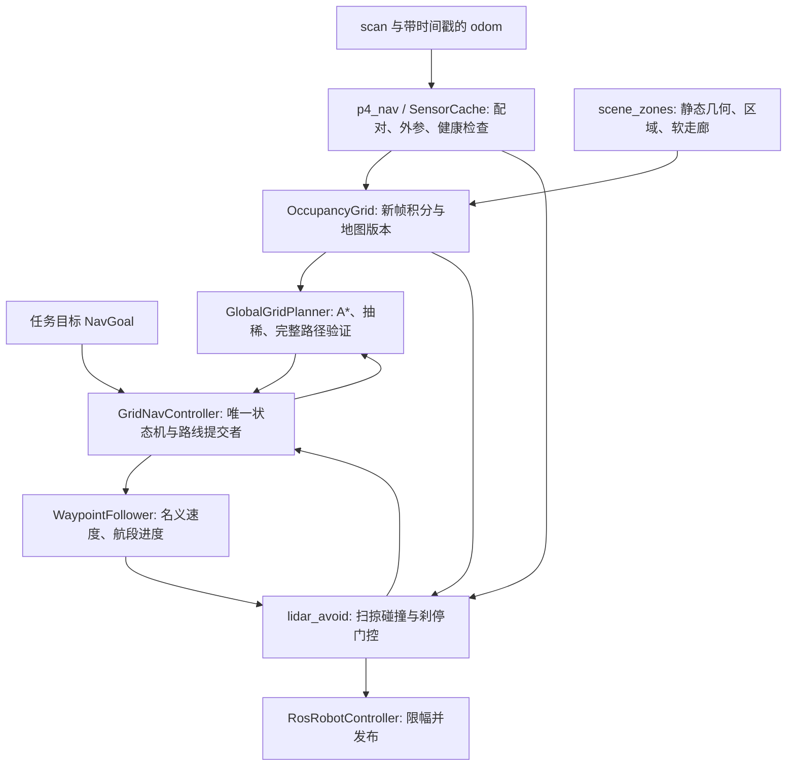
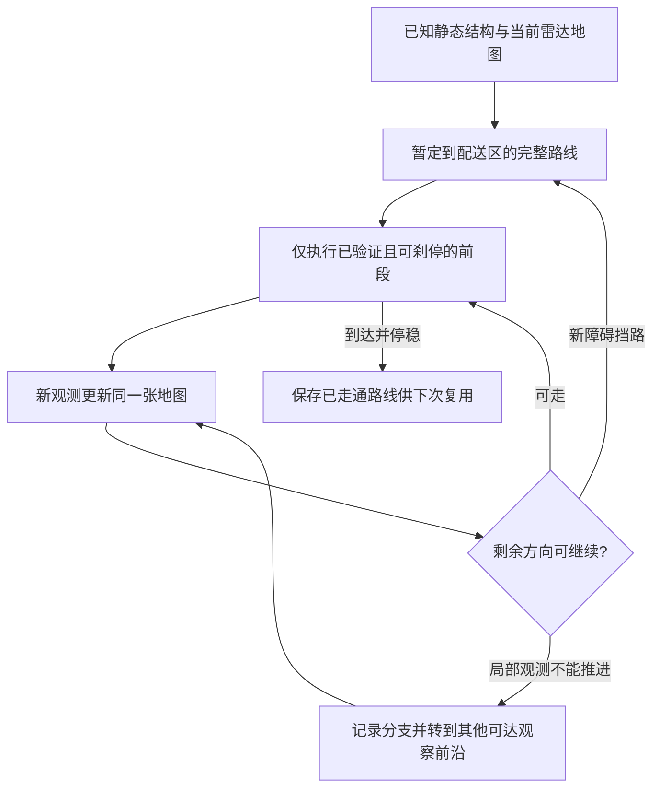

# DG-202606 P4 全图导航实现方案

日期：2026-09-07。代码仓：`D:\DG\supermarket_sorting`。

**文档性质：P4 设计真值。** 落地状态以 [DG-202606-P4-AGENT-HANDOFF.md](./DG-202606-P4-AGENT-HANDOFF.md) 为准，不要按下文第 2 节 9 月 6 日 hold 日志当代码还没改。S0–S6 已接到 `runtime/grid_planner.py`；仿真 `delivery_20260906_094432` 已 `arrived`。不提交 git commit，除非用户明确要求。

背景先读 [AGENTS.md](./AGENTS.md)、[AGENT-BRIEF](./DG-202606-AGENT-BRIEF.md)，历史方案和失败记录见 [P4 原任务文档](./DG-202606-P4-导航与全局规划.md)。原文同时保留了旧局部方案、第一版全图方案和后续补丁，不能把所有段落同时当作现状。第 2 节是 2026-09-06 改前的仓库核对，保留作对照。

## 1. 核心结论

继续使用 **已知静态场景约束 + scan/odom 持久占用栅格 + 考虑到达方向的 8 邻接 A* + 几何路径跟随 + 雷达安全门控**。沿用 `runtime/grid_planner.py` 中的核心类，不另起 Nav2、SLAM 或 DWA 系统。

用户补充的路线偏好：多条安全路线可选时，优先减少耗时的大幅转向，小幅方向调整尽量在移动中完成。因此路线优劣按预计执行时间与观测风险比较，不能只比较长度；第一次配送采用边观测边修正的探索流程，详见第 7.5-7.6 节。

用户提供的固定场景俯视图进一步说明：红、绿两种绕行方向都可能在第一眼看到前方箱体，但转过箱角后仍有通路。**前方命中不等于分支不通，遮挡后的空间不等于障碍。** 探索采用带目标与转向时间偏好的 DFS 式分支记录，具体运动仍由同一 A* 和安全层完成，详见第 7.7 节。

全图导航的含义是：在同一坐标系中记录全部已观测障碍，每次从真实当前位置搜索到任务目标的完整路径。全图不等于开局知道所有箱子，也不等于只能沿预设黄线走。未观测区域允许参与全局搜索，执行速度和下一段实际运动必须受最新观测约束。

关键设计决定：

1. **启动即允许 A***，不等“确认障碍格达到 8 个”才切换全局模式。空地图也能规划。
2. **唯一的路线写入者是导航状态机**。跟随器只消费路径；雷达安全层只否决或缩小运动指令，不自行左右选边。
3. **先统一几何含义，再调整半径**。实体墙、机器人中心禁区、走廊偏好分开表达；不能靠清掉墙的膨胀或目标格来制造通路。
4. **重规划是明确的状态转换**。新障碍先停车，再更新图和搜索；无解进入有次数和时间上限的恢复，不能继续跟随未经检查的固定路线。
5. **保留本局地图**。货架到配送、配送返回货架、失败重试共享地图，目标变化只清路线和控制状态。
6. **先验证任意有效起点到目标的可执行性，再追求提速**。日志中的规划次数少、`detours=0`、进入拣货区，都不能单独代表成功。

## 2. 当前仓库实际状态与证据

**2026-09-07 更新：** 第 2 节表格是 9 月 6 日改前核对。之后 S0–S6 已落地；`delivery_20260906_093534` 进配送区未到点；`delivery_20260906_094432` 报 `arrived=true`。细节见 HANDOFF。下面表格保留，避免把旧 hold / fallback 诊断丢掉。

| 项目 | 已核对的事实 | 对本方案的影响 |
| --- | --- | --- |
| 全图基础 | `grid_planner.py` 已有 `OccupancyGrid`、`GlobalGridPlanner`、`GridNavController`、`plan_to_waypoints` | 改造既有实现，不新建第二套规划器 |
| 9 月 5 日货架结果 | `shelf_20260905_075456.json`：到达，135.66 s 墙钟，`plan_id=50` | 历史成功不代表现版本已通过；“单 tick 位移”问题当前 `_note_progress` 已改为累计位移，仍需真实时间窗口和前进进度检查 |
| 9 月 5 日配送结果 | `delivery_20260905_075736.json`：停在 `(-1.472, 0.478)`，43 次规划，最后固定两点 fallback | 需要识别无解原因，以及证明所有回退路径仍可走 |
| 最新货架、配送结果 | `shelf_20260906_070722.json` 和 `delivery_20260906_071034.json` 均未到达，最终 `(1.066, 2.486)`、yaw `2.155`，持续 `hold`、`plan_id=1` | 增加越过近似禁区边界后的恢复；不能仅以“少重搜”验收 |
| 最新 hold 的代码路径 | `WaypointFollower._corridor_guard(global_mode=True)` 在 `in_north_racks` 内同时置零线速和角速；该点满足 `y >= 2.48` | 守卫命中必须产生有原因的事件，不能悄悄变成永久零输出 |
| 全图模式仍有局部决策 | `GridNavController._react()` 调用 `pick_detour_side`，产生 `face_turn`、`nudge` | `detours=0` 不能证明只有全局规划在决定方向 |
| 无解仍能发出不安全路线 | `fallback = self._fallback_route(...) or self._corridor_seed(...)`，后者绕过前者的碰撞检查 | 去掉无条件 `or` 兜底，所有可执行路径走同一验证入口 |
| 当前半径 | 静态 0.30 m、动态 0.22 m、放宽动态 0.18 m | 不沿用原文“当前统一 0.30 m”的说法，也不把 0.18 m 当作已证明安全的底盘尺寸 |
| 方向规则并不通用 | `early_southbound` 会将东通道 `(1.92, 0.0) -> (1.92, -0.1)` 判为非法 | 全图约束必须局限到真实墙角，不能全场禁止向南 |
| scan 更新 | `p4_nav.navigate()` 每轮拿缓存 scan，`GridNavController.integrate()` 每轮都积分 | 同一帧可能重复计票；运动后使用旧 scan 会把障碍画到错误位置 |
| 地图生命周期 | 每次 `navigate()` 都创建新的 controller 和 grid | 正式取送循环需要常驻导航对象 |

以上 hold 和东通道方向规则已用 `python -B` 的纯内存调用复核：清空障碍输入仍得到 `replan corridor -> hold`；同一位置在空栅格上直接调用 A* 能返回路线。这支持“控制守卫与地图不一致”的诊断，**不是对真实箱体布局或车辆物理状态的复现**。

本轮没有启动 Server、发底盘指令或重跑仿真。旧 `.log/.json` 没有原始 scan，不能从它们还原随机箱子的真实轮廓。

## 3. 任务范围与外部契约

### 3.1 约束

- 使用官方 Client/Server、ROS 2 Humble，评测离线；只依赖仓库和镜像已有能力。
- 通道障碍输入只用二维 `/slamware_ros_sdk_server_node/scan`，定位用 odom；不读取随机箱体的 Server 真值，不用视觉识别箱子。
- 所有底盘指令经 `RosRobotController.publish_velocity`。首轮使用既有限幅量级：线速不超过 0.35 m/s、角速不超过 0.65 rad/s。
- footprint 只按底盘计算，不把双臂展开宽度加入导航半径。上层在发起导航前完成已约定的升降、手臂携物姿态。
- 任务只保证 `id` 和 `kind`。商品在哪里由感知确定，不能从任务 JSON 猜商品坐标。
- 同一局失败后从当前物理状态恢复，不能自动重置 Server、布局或种子。另开测试局属于显式测试流程。
- 比赛预算为 420 s 仿真时间；当前脚本 150 s 是墙钟看门狗，两者分别记录。

### 3.2 导航目标与到达

定义 `NavGoal`，至少包含 `goal_id`、`kind`、`xy`、`final_yaw`、`xy_tolerance`、`yaw_tolerance`、`allowed_goal_region`、`deadline_sim`。

- `shelf_approach`：首轮兼容 `SHELF_APPROACH_XY` 和 `SHELF_FACE_YAW`。
- `delivery_approach`：使用 `DELIVERY_APPROACH_XY` 和 `DELIVERY_FACE_YAW`，并检查 `in_delivery_base`。
- `inspection_approach`：为 A-E 货架巡检提供通用目标接口。巡检层给出经标定的观察位置或感知生成的接近点，导航不生成商品真值；当前仓库没有可直接采用的五组完整接近点表，不能按等间距编造。

目标类型必须显式传入，不能再通过 `goal_xy[0] < 0` 区分货架与配送，因为西侧货架目标也可能是负 x。

默认位置误差不超过 0.12 m、朝向误差不超过 0.05 rad；位置、朝向、目标区域、底盘静止条件同时持续 0.30 s 仿真时间才报 `ARRIVED`。靠近任一航点、跨过终点投影、进入宽泛拣货区，都不算到达。低速静止阈值初值为线速 0.02 m/s、角速 0.05 rad/s，优先采用 odom 实测速度。

配送接近成功只表示底盘可以交给放置模块，不表示商品已被裁判判为成功配送。

### 3.3 同一局持续服务

`GridNavController` 所属导航会话在本局持续存在；`set_goal()` 只替换目标，清除当前路线、到达计时和恢复计数，保留地图。接入 `MissionOrchestrator` 时仍是“取一件 -> 立刻送 -> 下一件”。

地图标识使用 `run_prefix + frame_id + geometry_version`。只有明确新局、坐标系变化或定位跳变才能使地图失效；同局重试不清图。不默认从 `outputs/p4/last.json` 加载地图，该文件既没有完整占用数据，也没有足够的会话校验。首轮可保持地图仅在进程内存在，P4 单次 CLI 启动则重新观测建图。

## 4. 模块边界与数据流



| 文件 | 实现责任 | 不应承担的责任 |
| --- | --- | --- |
| `scene_zones.py` | 统一几何与区域来源；区分实体、中心禁区、软偏好 | 不维护观测到的随机箱体 |
| `ros_sensor_utils.py` | 保留消息 stamp、接收时间、scan 接收序号、短 odom 历史 | 不作路线决策 |
| `grid_planner.py::OccupancyGrid` | 纯 Python 地图、证据积分、占用和代价版本 | 不依赖 ROS、不发布速度 |
| `grid_planner.py::GlobalGridPlanner` | 搜索、起终点验证、路径验证、结构化失败原因 | 不偷偷改变目标、半径或清理地图 |
| `grid_planner.py::GridNavController` | 状态、重搜、恢复、路线原子提交、成功失败结果 | 不直接发布 Twist |
| `waypoint_nav.py` | 只读路径跟随，报告航段、进度、终点误差 | 全图模式不插点、不 rebase、不按西轨强行改线 |
| `lidar_avoid.py` | 最新雷达与地图的安全门控、速度上限、原因码 | 生产模式不 `pick_detour_side`、不替换角速度方向 |
| `p4_nav.py` | ROS 订阅、时钟、控制周期、调用编排、落日志 | 不再写第二份走廊或恢复逻辑 |

纯算法层建议固定以下数据契约，具体 dataclass 名称可随现有代码微调：

| 对象 | 必需内容 |
| --- | --- |
| `PoseSample` | `stamp_sim, received_wall, frame_id, x, y, yaw, linear_speed, angular_speed` |
| `ScanSample` | `scan_id, stamp_sim, received_wall, frame_id, ranges, angle_min, angle_increment, range_min, range_max, time_increment` |
| `MapUpdate` | `map_version, occupancy_version, changed_cells, newly_blocked_cells, accepted_scan_id` |
| `PlanRequest` | 当前真实 pose、NavGoal、地图快照版本、几何/footprint 版本、请求序号、`intent`（配送/观察/回退）、`branch_id`；观察子目标与主目标分开保存 |
| `PlanResult` | `status, failure_reason, path_xy, segments, start_connector, accepted_goal, map_version, cost, estimated_travel_s, large_turn_count, known_safe_prefix, first_unknown_region, min_clearance, expanded_nodes, search_ms`；`segments` 标注直线/圆弧几何、速度上限与是否停转 |
| `NavStepResult` | `linear, angular, state, reason, arrived, plan_id, progress_s, goal_error` |

`plan_id` 只在一条新的可执行路线提交时递增；另设 `plan_attempt_id` 记录搜索尝试。相同有效路线可以返回 `UNCHANGED`，失败和重复搜索不伪装成路线进展。

## 5. 几何、坐标系与地图定义

### 5.1 固定几何先做一次语义校准

现有常量包括导航经验阈值，不都是可直接膨胀的物理外形。例如 `NORTH_RACK_Y=2.48` 与 `SHELF_APPROACH_XY.y=2.475` 只差 0.005 m；若前者是物理货架表面，就不可能同时把后者当作半径 0.30 m 机器人的安全中心。隔墙顶端 1.90 到 2.48 的宽度只有 0.58 m，也容不下直径 0.60 m 的圆。**这首先是几何含义冲突，不能据此判断物理通道无路，也不能清膨胀硬开通道。**

实施阶段 S0 必须输出一份经核对的静态几何配置，每项标注 `source`、`kind`、坐标系和误差范围：

1. `physical_solids`：有官方固定场景定义或固定结构测量依据的墙、货架、配送桌投影、外墙。仅这些几何做底盘 Minkowski 膨胀；静态资料不能包含本局随机箱体或商品位置。
2. `center_forbidden`：已经针对底盘中心定义的禁止区域，不重复膨胀。`NORTH_RACK_Y`、`near_divider_nw_corner` 在校准前按历史行为阈值处理，不宣称是真实物体表面。
3. `preferred_corridors`：`WEST_LANE_Y`、`HUG_WEST_X`、`SOUTH_PEEL_Y` 和 `ROUTE_*` 形成的软代价带，不产生 free，也不覆盖障碍。
4. `NAV_BOUNDS`：现注释是导航搜索外包，不能自动等同物理外墙。搜索范围外一律不可规划；真实外墙另有实体几何时才据其做膨胀。

南缝禁止穿行用一个固定中心禁区表达，覆盖跨越隔墙南端的通道，**双向生效**；不禁止西走廊去配送点，也不禁止东走廊正常南行。西北角约束限于校准后的局部墙角，不使用“只要 x 大于 -0.32 就全图禁南行”的规则。

无法核定的几何不得通过放宽常量变成“已安全”。S0 的结果要明确哪些边界已经验证、哪些仍使目标不可用；这是一项具体实现前置工作，不留给调参时猜。

### 5.2 底盘与膨胀

第一版仍使用圆形底盘模型，便于安全原地转向和 2D A*。`R_body` 来自底盘碰撞模型在地面的包络；`margin_tracking` 来自跟随误差和定位误差，统一得到 `R_plan = R_body + margin_tracking`。静态实体和雷达箱体采用相同物理下限。

核定方法：从官方机器人碰撞模型取底盘/轮组的 collision 几何，按各 body/joint 的固定变换投到 base 平面，求以控制原点为圆心的外接半径；不使用渲染 mesh 的外观边缘代替碰撞体。用低速贴近固定墙的 scan/odom 对照检查外参与距离，再用直段/转角跟随的实测误差决定余量。只读取固定模型定义，不读取随机障碍布局；标定记录须带模型版本和测量条件。

0.30 m 作为旧方案的待校准起始参考，**不是本轮确认的真实底盘半径**。现有 0.22/0.18 m 也不构成测量依据。无解不能自动把半径降到 0.18 m；若圆形包络确实过于保守，另以实测矩形 footprint 与姿态相关碰撞检查评估，不在本轮假装“小圆也安全”。

栅格占用应计入格子面积，碰撞查询计算圆到占用格矩形的距离，或等价保守栅格化，不能只比较两格中心距离。额外舒适净空放在软代价中，不能同一物体硬膨胀两次。

### 5.3 坐标系与时间配对

默认全局规划坐标系与官方 odom 的世界平面一致，但启动时必须检查 `header.frame_id`、`child_frame_id` 以及静态地图的坐标定义。用固定场景资料/TF 确认 `T_world_odom`，不能仅把出生位看似接近就当作已验证。

每束雷达的二维变换为：

```text
p_world = T_world_odom * T_odom_base(t_scan) * T_base_laser * [r*cos(a), r*sin(a), 1]
a = angle_min + beam_index * angle_increment
```

`T_base_laser` 同时包含平移和偏航，来自已有 TF 工具或经核对的固定外参。没有 TF 但官方定义证实重合时可以显式配置单位变换，并记录来源；否则停在 `TF_UNAVAILABLE`，不静默猜零偏移。旋转和平移转换也必须用于安全层的雷达点，不能地图用一套、安全层用另一套。

保存约 2 s 的 odom 历史，按 scan stamp 插值位置和最短角差；启动默认匹配误差不超过 0.10 s 仿真时间，数据实测后再收紧。不能匹配的 scan 不积分。若 `time_increment` 有意义且整帧采样期间车体运动超过地图误差预算，按束插值；若官方 scan 是瞬时生成则按整帧 stamp，不伪造逐束时间。

新鲜度初值：scan 年龄不超过 0.30 s 仿真时间，odom 不超过 0.20 s；同时检查墙钟接收间隔，失联阈值取 `min(5.0, max(1.0, 3 * 最近有效消息墙钟周期中位数))` 秒，启动没有历史时为 1.0 s。任一超限立即置零并进入 `WAIT_SENSORS`，连续 8 s 墙钟未恢复返回 `SENSOR_TIMEOUT`。高速度下第 8 节的延迟制动约束仍可能要求更低速度。新 scan 必须覆盖候选运动方向的所需观测区域；全 NaN 或未经确认语义的全 inf 不构成健康、畅通输入。

### 5.4 栅格与图层

0.10 m 栅格，origin 和尺寸从 `NAV_BOUNDS` 得到，当前为 49 列、72 行，约 3528 格。向上取整形成的尾部半格仍按精确 `NAV_BOUNDS` 裁剪，不因数组存在就允许驶出边界。

分别保存：`static_solid`、`center_forbidden`、`observed_free`、`hit_score`、`confirmed_occupied`、`last_hit_sim`、`last_free_sim`、`free_streak`，再派生 footprint 碰撞层和净空软代价。静态几何不被射线擦除。

- `map_version`：接受新观测并使地图证据变化时递增。
- `occupancy_version`：硬占用掩码变化时递增，附带改变的格集合。
- `geometry_version`：几何/坐标系/footprint 配置变化时更新，使旧路径失效。

不要只比较“确认格总数是否增加”。一格新增、一格清除时总数不变，当前路径仍可能被切断。

## 6. 雷达建图与障碍记忆

### 6.1 每个新 scan 只积分一次

接收回调分配递增 `scan_id`，同时保留原始 stamp。新 `scan_id` 解决缓存重复读取；同 stamp 的重复消息去重，不能算多个独立命中。stamp 持续不推进必须报告时钟/传感器问题。20 Hz 控制可重复使用最新 scan 做时效范围内的刹停检查，但不能重复给地图加分。

积分上限初值 10 Hz，新消息可以合并丢弃中间帧；丢弃的帧不计确认次数。地图确认取决于实际接受的新观测，不取决于 `step()` 调用次数。

### 6.2 射线规则

1. 按消息 `range_min/range_max` 判断量程；`NaN`、负值、无效下限值不更新 free，也不作为畅通证据。
2. 有限命中 `range_min <= r < range_max - epsilon`：从真实雷达原点到命中格之前的格记 free，端点记 hit；`epsilon` 初值 0.01 m 并按发布器量化方式核对。
3. 量程上限或 `+inf` 只有在官方发布器语义确认为“未命中”时才沿射线清 free，不画端点。否则视为未知，不能把整张坏 scan 当开阔环境。
4. 观测使用 supercover 栅格遍历并裁到精确边界；遇已知实体静态墙停止，不能把墙后涂 free。观测射线穿过中心禁区或规划膨胀层并不等于穿实体，不应提前截断。
5. 一帧每格 hit/free 最多计一次，hit 优先于 free。自回波只按经校准的底盘内部区域/传感器遮挡掩码排除；不能泛化为“0.25 m 内所有障碍都忽略”。安全层仍处理掩码之外的有效近距离障碍。
6. 与已知静态墙面吻合的端点归静态证据，避免重复膨胀；判定依据是物理表面和误差容差，不能依据“离已膨胀墙很近”屏蔽真实贴墙箱子。

### 6.3 确认与清除的确定规则

- 初始 `score=0`，独立帧命中 `+2`、空闲射线 `-1`，截断到 `[0,5]`。至少两个不同 scan 命中且 `score >= 3` 时置 `confirmed_occupied=true`。
- 未确认端点保留为临时风险；最新近障碍进入安全层立即生效，不等待“两帧确认”后才刹车。
- 未确认孤立点 5 s 仿真时间无新命中可清除，但没有新 free 证据则回到 unknown。
- 已确认障碍在遮挡、转身或长时间未观测时保留。只有端点所在格被至少 3 帧连续的新 free 射线穿过，且 score 已降到 0，才能清除；任何新 hit 重置 free streak。
- free 证据 10 s 仿真时间未刷新后，执行层不再把它当实时安全证据；全局层保留“历史已观测 free”，初始费用可设为新鲜 free 的 1.3 倍，执行前逐段用当前 scan 复核。它不重新变成“从未观测的 unknown”，否则前沿会不断重生，回退路径也会被遗忘。障碍确认不随 free 的老化一起消失。
- 不逐帧把机器人脚下整圆清成 free；正确做法是拒绝自回波。如果仍产生起点冲突，输出原因并进入起点检查，而不是擦掉周围真实箱体。

这些时间和次数是实现初值，需在有噪声和实际 scan 频率下验收。地图记忆解决“两箱不能同时记住”的问题，多帧 free 证据则防止偶发误点永久封路。

## 7. 全局搜索、起终点与路径生成

### 7.1 搜索规则

采用现有 `heapq` A*，8 邻接，斜走时两侧正交相邻格都必须可通行。用同一个几何查询检查边，不在搜索后再补一套不同含义的墙角规则。

搜索状态改为 `(col,row,incoming_direction)`，方向取 8 个格网运动方向；第一条边使用机器人真实 yaw 计算起步转向，末端通过带对齐费用的虚拟目标节点接入 `final_yaw`。同一格不同到达方向分别保存代价和父节点。这样才能区分“从这里直行”与“到这里后还要掉头”。现有仅按格合并却附加转向费用的实现需要修正。

目标是降低预计完成时间，并对未观测路段和低净空加风险费用：

```text
J = T_motion + T_stop_turn_restart + P_unknown + P_clearance + P_corridor
P_unknown = lambda_unknown * unknown_length_m
P_clearance = lambda_clearance * integral(max(0, 1 - extra_clearance_m / 0.20), ds)
P_corridor = lambda_corridor * integral(min(1.0, 0.35 * corridor_distance_m), ds)
h = euclidean_distance_to_goal / v_max
```

各项单位统一为秒，风险项是可调的等效时间罚分，不宣称未知区一定存在某个数量的箱子。初值可令 unknown 直段总费用相当于相同 free 直段的 2.5 倍，再用实际取送日志调整；所有附加费用保持非负。启发式不添加未经证明的转向下界，确保不高估该搜索模型的剩余费用。

为控制第一版复杂度，A* 用局部转角的时间代理：每条边先计 `length/v_ref`，再计 `abs(delta_yaw)/omega_ref`，大转角额外计减速、停转、重新加速的实测开销。此代理会保守地高估部分能边走边转的小角度，**它是选路近似，不是最终控制指令或真实耗时证明**。方向状态最多约 3528×8 个，原 8000 格展开上限不能直接沿用，性能需重新测量。

得到路线后，先安全抽稀，再按真实连续几何评估转向：小转角若有足够净空，就用与两侧直段相切的圆弧连接，速度满足 `v*abs(curvature) <= omega_max` 且整个扫掠已验证。弧段时间为 `arc_length/allowed_speed`，不会再额外算一次原地转向；没有空间完成圆弧的急转，才计刹停、转向、起步时间。60° 可作为“大转向”的初始统计阈值，但能否移动中完成取决于净空和曲率，不能只看角度。

8 邻接造成的相邻 45° 折线不是要求机器人每格停转；同时，相隔很近的多个小折点必须作为一个整体转弯评估，不能把一个 90° 急弯拆成两个 45° 就免掉转弯费用。安全和净空始终是硬条件，不用削减安全距离换取少转向。

有明显内外通道等不同路线时，可在首次 A* 之后对该路线中段的有限局部区域加**软**重合罚分，再搜索最多两条候选，目标附近和必经窄口不加罚。全部候选均完整验证、做同一圆弧与执行时间评估，再按原始目标费用比较，去掉仅用于生成候选的重合罚分；不能只保留最短路线到跟随层才发现要频繁停转。候选生成共用本次请求的搜索时间预算，没有余量就使用已有有效结果，不因可选优化超时丢掉有效路线。有限候选不能保证连续空间中的全局最短时间，只实现用户要求的明确偏好。

若在 0.30 m/s、0.55 rad/s 的示意配置下，A 路长 5.0 m 且需 3 次停转 90°，B 路长 5.8 m 且只需 1 次停转 90°，仅计直行和转动约为 A=25.2 s、B=22.2 s，B 更合适；还未计入的起停开销会进一步影响结果。该例说明比较方法，不是实测成绩。起步朝向、终点对齐都要进入实际路线比较。

有效路径不因细小代价波动反复换侧。仅为优化而换路时，将当下刹停、转向和重新加速成本计入比较；初值要求净收益超过 `max(1 s, 剩余预计时间的 10%)` 才换。障碍使路径失效时立即按安全逻辑重搜，不受此收益门槛限制。

`extra_clearance` 是扣除底盘安全包络之后的额外净空。首选走廊由显式目标类别和当前起点所属区域确定，货架返回时必须包含西走廊北行，不把出生点当每条路线的起点。

unknown 可用于暂定完整路径搜索；下一段运动只有在最新雷达确认的可刹停空间内执行。走到可见边界前先减速，仍无法延伸观测才停车，由此逐步探索。障碍位置未知意味着不能提前证明整条路线可走，而非完全无法做目标方向的路线推测。

### 7.2 起点不能被悄悄搬走

先验证真实起点，再决定是否可以接入栅格链：

| 起点状态 | 行为 |
| --- | --- |
| 正常可通行 | 保留真实坐标，验证它到首个格中心的连接段 |
| 仅因舒适余量或网格边缘而受限 | 搜索 0.40 m 内候选，但必须满足真实欧氏距离上限和完整连接段验证，不能跨墙选最近 free |
| 落入已经验证的中心禁区，实体 footprint 尚未碰撞 | 仅恢复状态可构造离开该区域的短路径，要求禁区侵入量单调减小、物理扫掠安全；不允许正常导航向禁区更深处走 |
| 与实体墙或确认障碍的物理包络相交，或定位不可信 | `START_IN_COLLISION` / `LOCALIZATION_INVALID`；停车诊断，不能凭空投影到另一侧再宣布有路径 |

任何因余量而放宽的起点连接都只作用于这条短连接，不能改变整张地图半径。若不能证明连接安全，则返回结构化失败。

### 7.3 终点必须满足原任务意图

精确目标可走时，追加真实终点前再次检查最后一段。目标被箱体占用时，只能在 `allowed_goal_region` 与原目标容差的交集中选择候选，且报告 `accepted_goal`；对抓取目标，上层未提供可替代区域时不作替换。

0.80 m 内任意 free 格不一定是可抓取或可配送的位置。禁止先搜索到替代格，再无条件把被占用的原目标追加回路径；也禁止把目标格强制清空。候选为空返回 `GOAL_BLOCKED`，由上层安排新的接近点。

### 7.4 抽稀与统一验证

先保存完整 A* 格链，再做沿已验证线段的视线抽稀。只有当连接线通过完整碰撞检查才跳过中间格；急转角即使间距不足 0.25 m 也必须保留，不能为了航点间距好看而切角。之后生成候选圆弧连接，并再次验证完整扫掠；不安全的圆弧退回原来已验证的折线停转，不能只验证弦线就认为圆弧安全。

沿长直段约每 0.45 m 采样，短末段保留。最终验证对象必须是：**真实起点 -> 起点连接 -> 抽稀后的所有线段 -> 最终接近点**。验证全部静态、动态、中心禁区、边界和目标约束，不仅检查前方 1.5 m。

跟随器跳过近航点时也使用相同验证规则，不能在最后一次验证后靠 `_set_route()` 裁点、`_skip_near_waypoints()` 或 `rebase_west_south()` 再改出一条未验证的线。

`PlanResult.failure_reason` 至少区分：`START_OUTSIDE_MAP`、`START_IN_COLLISION`、`START_CONNECTOR_BLOCKED`、`GOAL_BLOCKED`、`NO_CONNECTIVITY`、`PATH_VALIDATION_FAILED`、`SEARCH_BUDGET_EXCEEDED`、`MAP_INCONSISTENT`。单一 `None` 不足以驱动恢复，1.4 ms 的失败也不能直接解释为搜索性能好。

### 7.5 第一次从货架到配送区，实际怎样找路

静态墙、可行区域与配送目标是已知条件；随机箱体初始未知。出生到货架过程中已经扫描到的部分应保留，因此第一次离开货架也不必主动丢掉已有信息。尚未看到的西侧通道仍保持 unknown，不填入假设箱子位置。

同一条路线明确分成两部分：`known_safe_prefix` 是当前能验证并满足刹停条件的连续前段，后面的 `tentative_tail` 穿过 unknown，只提供“接下来优先往哪里探”的方向。完整 A* 路线通过的是当前地图约束，不是对隐藏障碍作了保证。

一次首次配送的流程如下：

1. **在货架接近点获得初始观测。** 用已有地图与至少 3 帧新 scan，识别当前位置、周围净空、可离开方向。360° scan 一次覆盖多个方向，不为观察而默认整圈自旋。
2. **计算暂定完整路线。** 已知隔墙使“直接朝配送桌斜走”不可行；规划器通常先考虑沿北通道向西，再沿西侧通道向南，但内轨、外轨和连接位置都由地图及时间费用选择。未观测部分显式标 unknown。
3. **只沿已验证前段前进。** 每收到新 scan 就把视野中的空闲和障碍写图，延长 `known_safe_prefix`。前面一直可走就连续行驶，小幅转角在移动中调整，不每走一个栅格停车、重新规划。
4. **前方路径被新箱切断时换路。** 把新箱与已经看见的其他箱子一起考虑，比较内侧绕行、外侧绕行、必要的回退路线，偏好预计耗时低且大转向少的可行方案。近障碍或当前路径不再安全时先停车，不能为了减少停转继续冲向未知空间。
5. **绕过一箱后看到第二箱，继续修正同一张图。** 不能忘掉第一箱后又被第二箱赶回原缝；也不能因为旧目标在内轨，就强行回内轨。目标仍是配送区，全局路径从当前实际位置重算。
6. **当一侧暂时探不通，系统性换分支。** 按第 7.6 节走到另一个可达观察前沿；可以先向北回退、再向西绕开，不能强制每步都离配送点更近。确认的阻塞保留，已尝试位置被记住，不在原地左右重试同一选择。
7. **已知可行路线连到配送点后，完成导航。** 此时后段不再依赖未知通路假设，仍以最新 scan 门控跟随并完成终点姿态。走通的走廊与障碍保留给后续取送复用。



### 7.6 找路不能只靠局部试探：探索前沿与回退

`frontier` 是“已知可通行区与从未观测的 unknown 相邻”的边界。观察目标选在边界的已知 free 一侧，并保留完整底盘净空；到这个目标的整条连接路径必须已有可通行证据，允许采用历史走过的 free 路段，但实际执行前段必须用最新 scan 复核。地图增长后，机器人可以从那里看到原先遮挡的更远区域。

维护一个探索记录：前沿分组 ID、候选观察位置、通向它的已知路径、首次发现/最近访问时间、已尝试姿态、增加的有效可见格、被证实阻塞的连接，以及对应局部地图版本。前沿变化后更新或合并记录，不仅保存一个临时左右选择。

选择下一前沿时，先延伸当前正在探索、仍有安全可达观察位置的分支，不因另一侧稍近就反复换侧。需要选择新分支时，优先估计 `已知路径到前沿的行驶与转向时间 + 前沿到配送点的乐观剩余代价`，兼顾能否看清当前阻塞区；候选时间接近时偏好信息增益更大者。通过访问次数惩罚和等待队列防止总挑同一个前沿，仍有未尝试可达候选时不重复同一无收益观察位置。收益不足或无新观测的位置，在局部几何证据不变时暂时不再尝试，单纯刷新时间戳不能重置访问历史；不能因为一次看不清就把尚未验证的整个通道永久标成不可达。

如果最近的前沿走不通，回到已知可行连通区域，从全部可达前沿中选下一个，包括距离大于 0.60 m、需要先远离配送点的前沿。第 10 节的 0.60 m 范围和两次尝试只限制一次局部脱困，**不限制整次配送的探索范围**。已知回退路线也要用最新 scan 复核；正常回退可以转身后沿旧路前进，不等同于盲目长距离倒车。

前沿搜索只要求“到观察点”已知可走；观察点之后的 unknown 用于预测价值而非直接执行。一个候选应有未验证的目标相关连接或有望扩大可达已知区域，不为重复扫描整片已知墙面耗时；但不能用“必须降低目标欧氏距离”排除必要绕行。

找路的进展至少满足其一：沿有效路线接近子目标、确认新的 free/occupied 区域、排除一条具体候选连接、转向尚未访问的可达分支。没有进展且局部地图未变，就升级到其他前沿或返回诊断，不能靠 `plan_id` 一直增加假装探索。

**保证的范围要区分：** 在障碍静止、定位和观测可靠、通道具有足够净空并能被 0.10 m 模型表示、传感器能逐步观察通路、允许回退、且没有时间上限的理想条件下，对有限栅格中的可达前沿作不遗漏的搜索，可以找到模型中存在的通路。正式有 420 s 时间限制，当前实现尚未验证这些条件，因此不能承诺任意随机布局都必定按时到达，更不能提前保证未知环境中的最短时间路线。

若把所有 unknown 乐观视为可通行仍搜索不到到目标的连接，原因已不是“还没去看”本身：需检查确认障碍、几何/膨胀、目标和地图误差。只有已知连通区的可达前沿都处理完且模型仍不通，才能报告 `NO_REACHABLE_ROUTE`；预算先耗尽应报告 `EXPLORATION_BUDGET_EXHAUSTED`，不能把“尚未探索完”写成“确定无路”。

### 7.7 配图中的红绿通路：带目标偏好的 DFS 式探索

本节对应用户提供的固定场景俯视图：右侧为货架通道，左上侧为配送方向；箱群中画出了红、绿两种绕行可能。图片用于说明分支与遮挡，实际雷达视野仍由机器人位置决定；不能从俯视图假定初次 scan 已看清所有箱子的侧面和背面，也不能用线条宽度判定底盘一定能通过。正式地图仍由 scan 构建。

#### 7.7.1 三个不同问题必须分别回答

| 问题 | 所需证据 | 对行为的影响 |
| --- | --- | --- |
| 当前直行会不会碰到箱子？ | 当前运动扫掠与近回波相交 | 停止或调整该运动，不能直接宣布整条分支失败 |
| 能否沿箱子侧面走到下一个观察位置？ | 存在已观测、有足够底盘净空的短路径 | 可以深入观察，不需要先看到箱子背后全部路线 |
| 这个绕行分支是否确实不通？ | 已确认障碍/墙使具体连接没有足够净空，且该分支没有尚可探查的延伸 | 才能标记该连接阻塞或在子分支耗尽后回退 |

被箱子挡住的背后区域仍是 unknown。一次 scan 中的 `ahead` 较小、一次到主目标的规划失败、一次观察位置没有新信息，都不能单独作为“红线/绿线整条不通”的证据。

#### 7.7.2 从哪里继续向前观察

候选不是“箱子后面那个尚未看见的点”，而是沿当前 free 区域、靠近遮挡边界且保留底盘余量的位置。例如先沿箱子侧面前进一段，雷达原点发生平移后，原先被箱角挡住的空间开始露出；新露出的 free 再允许下一段移动。

下一执行段长度取安全扫掠与制动条件允许的范围，初始可把 0.20-0.40 m 作为观察目标间隔参考，实际可以更短；它不是固定绕行插点。能连续获得新信息时滚动延长执行前段，不要求每走完这个距离就停车。若下一小段仍无法证明安全，就停下换一个已知可达观察位置，不能以“DFS 要深入”为由驶入不可刹停的盲区。

原地转动 360° 雷达不能普遍看穿箱子。解除此类遮挡通常需要**平移观察位置**；规划层选择朝向与曲率合适的路径，不能把“深入”实现为没有目标的左右转头。

#### 7.7.3 分支记录与探索顺序

使用在线发现的分支图，加当前探索栈；它是既有地图和状态机上的记录，不是预先手写红、绿固定路线，也不是第二套速度控制器。节点表示可以选择不同通道的已知区域或观察锚点，边表示通道候选；机器人从某一侧接近箱群时才根据实际可见开口生成分支，不按每个栅格建一个栈节点。

每个分支至少记录 `branch_id, parent_id, anchor_pose, candidate_ports, active_port, status, local_evidence_version, attempted_viewpoints, breadcrumb_path, blocked_evidence`。状态含义如下：

- `UNTRIED`：入口候选存在，尚未沿该方向观察。
- `EXPLORING`：正在深入，后方仍可能被遮挡；遇到新箱时通常仍属于此状态。
- `CONNECTED`：已验证连接到另一个已知区域或主目标；连接到普通区域不等于已经到配送区。
- `BLOCKED_CONFIRMED`：具体连接有可信的障碍/净空阻塞证据；节点所有可行子连接都处理后才可宣告整个分支耗尽。
- `DEFERRED`：当前观测、控制或预算不足，暂存以后再试；不等于物理上确定无路。

在一个新分岔处，先按通行净空、预计到目标的时间与大幅转向开销给候选排序。选定一个后保持探索方向；只要能够安全延伸并产生信息，就继续深入。遇到新的分岔，把当前锚点与未试方向压栈，先探排名靠前的子分支。

遇到前方箱体时，优先在当前分支内寻找侧向延伸或新观察点，不立刻弹栈、不立刻切回另一种颜色。只有当前分支的可达延伸已处理，或经检查暂时不能安全继续时，沿经过验证的 `breadcrumb_path` 回到最近有未尝试出口的锚点，再试下一分支。回退中也可以采用已有 free 连通图中的更短安全连接，不必逐点倒着重放历史控制命令。

不同探索路径可能会合到同一区域，所以记录必须支持合并节点和已验证边；不能把真实场景当作互不相交的严格树。到已访问区域不自动判死路，先检查能否接上已知到目标的路径。单纯重复访问且没有新增连接/观测的环才需要去重。

找到一条完整可信的配送路线后即可执行，不要求首趟先把红、绿两路都探完。已有观测足以证明另一条明显省时，或当前路线失效时，才按路线切换规则改道。这样既有 DFS 的深入与回退能力，也避免无目标地扫完整张地图。

#### 7.7.4 按绿线先探的示意过程

假设机器人已到图右侧能进入箱群的区域，当前代价比较选中绿线方向；这只是解释顺序，不预设绿色一定优于红色。

1. 记录当前分岔锚点 J0：绿色候选 `EXPLORING`，红色候选 `UNTRIED`。
2. 朝绿线方向看到箱面，标记箱面占用与背后 unknown；直行受阻，但不把绿色标为 `BLOCKED_CONFIRMED`。
3. 沿已看清的箱侧空间前进，接近可以看到箱角后方的位置，雷达逐步揭示新的 free 区域。
4. 若新空间仍可走，继续沿绿色深入；若出现两个可绕方向，在 J1 记录分岔并探其中一个。
5. 某个子方向被墙/另一箱真正封住，则只标记这条子连接；退回 J1 试剩余方向。J1 的候选确实耗尽后，才继续退到 J0 尝试红色。
6. 任一分支连到配送区域的已知可行路径后，完成导航。另一条尚未探查的路径保留为候选，不为证明它也能走而额外往返。

#### 7.7.5 与执行状态机的关系

`EXPLORE` 是正常的首次导航行为，不必等到两次 A* 失败或用完 15 s 局部恢复才启动。完整路线含遮挡未知区，且需要通过移动延长可见区域时，就选择观察子目标。

状态流为 `EXPLORE（选当前分支的观察子目标） -> PLAN -> FOLLOW -> 更新图/到观察点 -> EXPLORE 或直接规划主目标`。跨越这些状态时保留 `intent=observe`、主目标与 `branch_id`。观察点到达只完成子目标，不能对外返回 `arrived=true`；主目标的位置、朝向与停稳条件满足才报告成功。

`RECOVER` 专门处理车辆卡住、中心禁区、配准异常等执行问题；正常发现遮挡、沿箱侧深入、分支回退由探索记录管理，不重复消耗“发生一次故障”的局部恢复计数。安全刹停始终优先，DFS 只决定之后探索哪一个分支，不直接发布转向或前进指令。

## 8. 跟随与安全门控

### 8.1 跟随器不再拥有路线策略

沿用 `WaypointFollower` 的朝向控制和终点对齐，但全图模式下关闭 `insert_ahead`、`rebase_west_south`、`_cuts_back_east` 等走廊路线重写行为。旧局部模式 API 可以保留供兼容测试，生产调用链不得进入它们。

首个航段固定使用提交路径时的真实起点，后续航段使用前后路径点。不能每 tick 都把当前 pose 当作首段起点，否则第一段横向误差永远为零。进度 `progress_s` 用活动航段附近的弧长投影计算，限制投影搜索范围，避免路径绕回时误跳到后面的近邻段。

直段按剩余距离、航向误差和允许速度行驶。使用规划层已验证的连续直段/圆弧，小角度方向调整在移动中完成；只有净空不足或速度/曲率约束要求停转的急弯才停车。不能用大 lookahead 擅自切过黄线墙角，跟随中的实际圆弧仍通过第 8.2 节验证。路径接口应携带转弯类型和允许速度，避免规划层认为可以连续转、跟随器却在每个短航点停车。

旧 `_corridor_guard` 中基于位置一刀切的零输出改为明确事件，例如 `CENTER_GUARD_VIOLATION`，交给状态机决定是否执行安全退出。正常跟随不自行逃离禁区，恢复也不能绕过物理碰撞检查。

### 8.2 规划净空与刹停距离分别计算

地图 footprint 处理“几何上能不能通过”，刹停处理“当前速度下能不能及时停下”。固定 `STOP_DIST=0.43` 不能覆盖所有速度，也不能代替侧面或后方检查。

使用最新 scan 转成底盘坐标的点，加地图中的已知占用，对候选 `(v,w)` 的差速运动圆弧做扫掠检查。路径采样平移间隔不大于半格；圆形 footprint 原地转动不扩大包络，但必须先确认当前整圈底盘空间安全。倒车检查后方，圆弧检查侧向，不仅使用正前 ±0.22 rad 的一个锥。

安全层把近期 free 射线覆盖之外的空间作为当前执行视野边界。因此 `d_free` 同时截断在首次碰撞或未观测边界，不能把“点云里没有端点”当作已观测 free。采样之间的运动也需覆盖：检查相邻采样中心的扫掠胶囊，或等价加入半步长误差包络，避免离散采样漏掉擦角。

令 `d_free` 为沿候选运动到首次 footprint 碰撞的可行距离，`v` 为 odom 实测速度与近期命令估计的保守值，则必须满足：

```text
d_free >= abs(v) * tau + v*v / (2*a_brake) + margin_stop
```

`tau` 包含 scan 年龄、控制延迟、地图/搜索可能的阻塞时间；`a_brake` 和控制响应由低速仿真测量。这里 `d_free` 已扣掉 footprint，不再把底盘半径重复加一遍。尚未完成制动标定时只使用低速配置，0.43 m 可作为原有正前保护参考，不能因此放开 4×/8×。

门控先取跟随器产生的名义指令，再按可行净空缩小 `(v,w)` 或置零；保持原有转向意图，不擅自换成“更空的一侧”。若调整会改变运动轨迹，重新检查调整后的轨迹；最简单可采用等比例缩放保持曲率，原地转向另行验证。雷达障碍挡住向前运动时，朝远离障碍方向的安全转动/倒车不应被同一个前向阈值错误禁止。

新命中未达到确认阈值时，安全层立即停车。规划重试使用这些真实新端点构成的临时阻塞层，避免持久图尚未确认就返回同一条迎面路径；临时层按新观测更新，不凭空把整片 unknown 或整条路线画成箱体。

所有分支统一经过门控和限幅，包括恢复、终点转向、替代观察点运动、倒车。丢 scan、定位异常、计算超时的输出都是 `(0,0)`，不允许恢复分支提前 return 绕过门控。

### 8.3 速度与时钟

正式初始配置保持约 0.30 m/s 巡航、0.55 rad/s 转向，并受现有限幅保护。之后只在制动距离、定位配对误差、控制周期均通过后提高上限。当前 `--speed-scale 4` 实际把速度上限提高到 1.20 m/s，**不是把仿真运行速度调成四倍**。

运动进度、恢复动作时长、障碍证据老化和 420 s 任务预算使用仿真时间；计算耗时、消息接收失联、ROS 回调卡住和脚本看门狗使用单调墙钟。优先使用已确认与 Server MuJoCo 时间一致的 `/clock`，否则使用验证过的消息 stamp，并明确时间起点。不能每次 `navigate()` 重置比赛已经消耗的时间。

`dt` 来自真实相邻仿真时间戳，不能把固定 `period=0.05` 当实际物理步长。仿真暂停时不累计停滞；墙钟看门狗仍能发现消息断流并发零速。仿真时钟回退或 odom 不连续时进入定位异常状态，使旧地图和路径失效，不能直接继续积分。

## 9. 导航状态机与重规划时序

### 9.1 状态及其唯一速度来源

| 状态 | 进入条件 | 输出与退出条件 |
| --- | --- | --- |
| `WAIT_SENSORS` | 启动、scan/odom/TF 缺失或不新鲜 | 零速；收到可配对的新数据才进入 `PLAN`，启动等候默认最多 8 s 墙钟 |
| `PLAN` | 启动、目标改变、失效路线需要替换 | 先实际发布零速，再搜索；有效结果原子提交后到 `FOLLOW`，失败到 `OBSERVE` 或相应终止状态 |
| `FOLLOW` | 有有效计划 | 跟随器提供名义指令，门控执行；命中失效条件到 `BRAKE_WAIT`；位置达标到 `ALIGN_GOAL` |
| `BRAKE_WAIT` | 新近障碍、路径失效、跟随异常 | 零速并锁存原因；刹停后收集新帧，满足重搜间隔再到 `PLAN`，期间不恢复旧直行命令 |
| `OBSERVE` | 地图证据不足或可恢复的搜索失败 | 原地等待至少 3 帧新 scan；必要时进入明确的 `RECOVER`；变化足以重试时到 `PLAN` |
| `RECOVER` | 第 10 节规定的一个有界动作 | 只执行该动作并统一门控，结束即停车回 `PLAN`；不能同时调用正常 follower |
| `EXPLORE` | 首次路线含遮挡未知区需主动观察，或当前分支耗尽需回退换分支 | 按第 7.6-7.7 节选观察/回退子目标，进入 `PLAN/FOLLOW` 时保留探索意图；更新图后延伸分支或规划主目标，不清探索栈；子目标完成不报主目标到达 |
| `ALIGN_GOAL` | 达到位置与目标区域条件 | 线速为零，安全地完成 final yaw；位置漂出容差则重新规划，全部到达条件满足后到 `ARRIVED` |
| `ARRIVED` | 全部到达条件稳定满足 | 零速，向上层报告成功；新目标启动下一次导航 |
| `BLOCKED` / `FAILED` / `TIMEOUT` | 恢复预算耗尽、不可恢复输入错误或期限到达 | 零速，返回结构化原因；上层可从当前状态重新给目标，本状态不隐式清图或重置场景 |

正常状态输出零速时必须有原因和退出条件，不能只报无限期 `hold`。`ALIGN_GOAL` 也有转向停滞检测，不能把所有“正在转向”都永久排除于失败检测之外。

### 9.2 控制循环

```text
每轮控制周期:
    接收消息，读取一个一致的传感器快照
    检查时钟、TF、odom 和 scan 新鲜度
    传感器异常 -> 立即发布零速，更新 WAIT_SENSORS/FAILED，结束本轮
    若 scan_id 尚未积分且可时间配对 -> 更新地图、临时障碍与版本
    根据状态、真实运动进度、改变的路径格产生事件
    若事件使路线失效 -> 锁存原因，先发布零速，再等待重搜
    若进入 PLAN 且到重搜时刻 -> 对地图快照搜索和完整验证
    仅有效结果可原子替换 active_plan；恢复动作与正常跟随互斥
    计算本状态的名义速度 -> 扫掠与刹停门控 -> 控制器限幅发布
    记录状态转换、速度来源和路线版本
```

20 Hz 为目标频率。同步 A* 第一版可以保留，但必须在调用搜索前真正 `publish_velocity(0,0)`；不能只让 `step()` 在搜索结束后返回零速，因为搜索期间机器人仍可能执行上一条命令。控制层需要单调墙钟驱动的失联停车能力，不能只依靠 `finally`：初始控制心跳超时为 0.25 s 墙钟，独立看门狗通过同一个 `RosRobotController` 发零速并锁存；发布做串行仲裁，过时的非零命令不能覆盖停车。恢复须重新获得健康输入和有效路径。

搜索初始墙钟预算 100 ms，超时返回 `SEARCH_BUDGET_EXCEEDED` 并保持停车；性能目标为典型搜索小于 50 ms，记录分位数和超预算次数。若同步搜索持续压住传感器回调，再把同一个规划器移至单工作线程：只处理最新请求，结果提交前核对目标、起点偏移和当前地图碰撞，过时结果丢弃。不要在第一版引入多个并行规划来源。

### 9.3 触发条件与去抖

| 事件 | 初始判定 | 动作 |
| --- | --- | --- |
| 启动/换目标 | 传感器健康，至少 3 帧初始观测 | A*，与已确认障碍数量无关 |
| 前方路径被占 | 新硬占用与剩余路径前 1.5 m 相交 | 立即停止，按最新图重搜；不跳过起点后的 0.30 m |
| 更远路径被占 | 新硬占用与剩余路径相交，但不在紧急范围 | 标记待重搜，第一版也停车更新，避免以后驶入已知死路 |
| 最新雷达扫掠不安全 | 第 8 节条件不满足 | 当轮刹停，收集独立新帧确认并重搜 |
| 遮挡限制可见前段 | 当前分支尚有安全可达的观察位置 | 正常进入/继续 `EXPLORE`，延伸可见前段；不把前方命中或 unknown 当整条分支失败 |
| 偏离路线 | 活动航段横向误差 >0.35 m 持续 0.50 s 仿真时间 | 停车，从真实位置重搜 |
| 平移无进展 | 有明确前进意图，1.5 s 窗口内弧长前进 <0.05 m，且位移/往返历史显示未脱困 | 停车诊断和重搜，不要求“新确认格增加” |
| 转向无进展 | 有转向指令，2 s 仿真时间 yaw 变化 <0.05 rad | 报 `TURN_STALLED`，进入有界恢复；不无限免检 |
| 定期评估 | 距上次完整验证 8 s 仿真时间 | 仅验证剩余路径；仍有效则保持 `plan_id`，不强制搜索 |
| 禁区守卫/定位变化 | 中心禁区事件或 pose 不连续 | 区分可安全退出与定位错误，不归入普通 `hold` |

平移无进展只统计期望确实移动的区间，例如名义速度至少 0.08 m/s；被门控停车的时间由阻塞状态管理。滑动窗口保留真实时间与位置，累计路程不能代替沿路线的净进展，否则左右往返也可能被当作成功前进。

搜索最多每 0.50 s 仿真时间一次，并加至少 0.10 s 墙钟间隔。紧急刹停不受搜索频率限制。原方案的 1.5 s 规划后保护只允许抑制软偏离/性能抖动，**不能屏蔽新障碍和传感器异常**。

相同目标、近似相同起点、相同硬占用与近障碍证据下连续 2 次失败，就进入恢复而非重复搜索。同一恢复事件的失败计数不因“又发了一条 fallback”清零；只有明确运动进展、到达观察点或阻塞真正消失才解除。

## 10. 无解与恢复：选择下一步证据或安全动作

首先按失败原因分支。`TF_UNAVAILABLE`、定位异常、实体碰撞、非法目标不能用盲目转向解决；`SEARCH_BUDGET_EXCEEDED` 先处理计算预算。以下流程用于输入健康、目标合法而当前图/姿态暂时无法通行的情况。

### 10.1 恢复顺序

1. **停车观测。** 至少收集 3 帧新的、可配对 scan，重新核对起点、目标、临时命中、静态回波误分类和阻塞路径格。没有观测变化不反复声称“地图已经更新”。有安全可达的观察点时优先移动到观察点，避免没有信息收益的原地大转向；以下动作按触发条件选择，不要求先做完转向才允许平移。
2. **起点退出。** 若仅落入中心行为禁区或规划余量，按第 7.2 节生成单调退出连接。最新 `(1.066,2.486)` 用例属于需先核定实体净空的场景，不能硬编码一次南退来掩盖错误地图。
3. **有限转向观测。** 雷达是 360°，原地转动通常不能看到箱体后方；只在传感器存在固定遮挡、角分辨率或配准验证需求时使用。整圈 footprint 安全才允许转，最多两个 90° 分段，完成条件根据实际 yaw，每段最多 4 s、合计最多 8 s 仿真时间；0.55 rad/s 转 180° 理论上已需约 5.7 s，不能沿用“4 s 内必转完 180°”的假设。达不到角度就报失败，不按命令时间假装转完。
4. **移动到可达观察点。** 执行故障恢复时，在机器人当前连通的、近期已观测 free 区域中寻找靠近 unknown 边界的候选点，距本次恢复起点不超过 0.60 m。候选点必须有已观测可行路径，预计可以观察阻塞侧面或后方；信息增益用在该候选位姿模拟射线所能看到的 unknown 格数估计，以增益优先、路程次之排序，用同一个 A* 搜索到该点，线速不超过 0.15 m/s。最多尝试两个不同位置，记录已尝试位置，不能反复返回同一点。正常沿箱角向前观察按第 7.7 节执行，不受本次故障恢复的局部次数限制。
5. **一次短退。** 若有最近已走过且重新验证为 free 的后方轨迹，可沿其后退不超过 0.15 m，线速不超过 0.10 m/s、最多 2 s 仿真时间。持续检查后扫掠，后方不明或被占用则不退。退后停车、取新帧、重新规划，不直接恢复旧南向速度。
6. **结束本地恢复并决定是否扩大探索。** 一个连续阻塞事件的本地恢复预算初值 15 s 仿真时间，且受任务剩余时间和脚本墙钟上限约束。局部方法用尽但尚有其他已知可达前沿时，进入 `EXPLORE` 并保存分支记录；只有不能安全退出/回退时才返回 `BLOCKED`。各步共用本地预算，不能到一个新点就无限刷新同一事件的计时；整次探索另受 `NavGoal.deadline_sim` 限制，超时返回探索预算耗尽。

观察点是状态机管理的临时子目标，不进入生产主路线做左右 detour；主任务目标始终保留，观察结束重新从当前位置规划到主目标。候选搜索仅在已观测 free 连通分量内进行，执行前段始终采用当前 scan 复核，不能沿从未观测的 unknown 路段执行恢复试探。主目标改变时可以清本次恢复计数，但同一配送过程内的前沿访问与失败连接记录不能随子目标切换清空。

### 10.2 明确删除的退路

- 不用 `_fallback_route(...) or _corridor_seed(...)` 使检查失败的黄线重新可执行。
- 不因为无解就清图、强制清起终点、缩小到未经验证的底盘半径。
- 不强制外道必须走到 `x=-1.9`，也不绕箱后强拉回 `x=-0.40`。
- 不用“官方保证有路”代替当前地图、footprint 和可观测性的检查。保证有物理通路不保证当前近似地图一定连通，也不保证错误圆形尺寸一定能通过。

固定黄线只作为软代价和测试参考。若确有一段已验证安全的黄线路径适合移到观察位置，它按第 10.1 节作为普通恢复路径提交；它没有绕过 A* 或碰撞验证的特权。

### 10.3 两箱场景应怎样运行

以 `delivery_20260905_065322.log` 为参照：原车从 `(-0.44,-0.84)` 向西偏移到约 `(-0.75,-0.88)` 后，又在两块障碍影响下反复 `blocked_left/blocked_right`，旧目标仍把车拉向 `(-0.40,-2.70)`。

新流程应是：第一箱的有效近回波让车刹停；独立新帧确认后，A* 在同一地图上规划整个配送路径。行进看到第二箱时，把第二箱加入已有地图，保留第一箱，重新搜索从当前位置绕过两者的路径。如果未知区的实际缝隙无法通行，进入观察点恢复，获取侧面证据后再搜。换路线仅发生在提交 `PlanResult` 时，安全层不同时发另一套左右决策。

记录 `plan_attempt_id`、`plan_id`、阻塞格、路径指纹与进度。同一路线反复撞上同一批端点必须进入恢复；不能仅仅递增版本就认为问题解决。最终必须到配送目标并完成朝向，或在有明确证据的不可恢复状态下停止并报告，不能循环 150 s 只留下 `turn`。

## 11. 观测与诊断交付

保留现有 `outputs/p4/{goal}_{stamp}.log/.json` 和 `last.json` 的使用方式，新增字段而非无说明地破坏调用者读取格式。状态转换立即记日志，常规进度可维持每 2 s 墙钟一条。

每次规划记录：触发原因、状态转换、真实起点/格/朝向、目标/格、起终点被哪一层阻塞、地图和几何版本、半径与安全余量、结果码、展开状态数、耗时、最小净空、路径点、预计行驶时间、大幅停转次数、是否与上一计划相同。探索时额外记录已验证前段长度、下一个未知区、前沿 ID、选择/放弃原因、观测增量与回退路径。日志需要区分“地图未连通”“起点连接失败”“抽稀后失败”。

每次控制诊断记录：`scan_id`、scan/odom frame、stamp 差、消息墙钟年龄、有效束数、当前/名义/输出速度、门控原因、实测速度、横向误差、沿线进度、位置/朝向误差。这样才能区分守卫强停、刹车、仿真暂停、底盘不响应。

最终 JSON 至少有 `arrived, in_zone, failure_reason, elapsed_wall_s, elapsed_sim_s, plan_attempts, plan_commits, safety_stops, recovery_counts, min_clearance, timing_overruns, geometry_version`。保留 `elapsed_s` 时注明它是墙钟兼容字段。

调试模式下追加体量受控的原始记录：每次被接受的 scan 及其量程/角度/stamp、配对的 odom/外参、目标、配置、状态和地图快照。可用标准库 JSONL/gzip，固定数组与元数据用镜像已有工具；仅在状态转换或抽样点存地图。提供纯 Python 重放入口，使同一传感器序列产生可比较的地图、路径与状态，而不依赖浏览器或 Server 重置。

## 12. 实现顺序与阶段交付

实施按依赖顺序推进，任一时刻只维护一套正式规划路径。S0–S6 已接到代码（2026-09-07）；下表仍是验收清单，不是「还没开始」。未完成的主要是 S0 四项核定、完整 DFS 探索栈、出生/货架整段新速度仿真。

| 阶段 | 文件与工作 | 完成条件 |
| --- | --- | --- |
| S0 几何与输入核定 | `scene_zones.py`、传感器配置；核对静态结构、中心区、激光外参、坐标系、底盘尺寸、时钟和量程语义 | 有可追溯配置；解释 2.48/2.475 冲突；固定货架与配送接近点可按同一几何验证，不能靠 carve |
| S1 地图 | `ros_sensor_utils.py`、`OccupancyGrid`；新帧去重、时间配对、射线、证据、地图版本与会话保留 | 同帧不重复确认；转动不产生地图漂移；旧箱遮挡不丢；多帧 free 可清误点 |
| S2 规划与路径验证 | `GlobalGridPlanner`、`plan_to_waypoints`；方向状态、时间代价、候选路线、起终点连接、禁止切角、软走廊 | 无箱、单箱、两箱、任意合法起点和双向通路测试通过；适当绕远能减少大停转；不能产生跨障碍起点连接 |
| S3 跟随与安全层 | `waypoint_nav.py`、`lidar_avoid.py`；路线只读、拐点保持、扫掠门控、制动标定 | 实际积分轨迹不切墙；前/侧/后障碍和终点转向均受门控 |
| S4 状态机接入 | `GridNavController`、`p4_nav.py`；暂定路径/安全前段、前沿与分支记忆、规划前停车、停滞和恢复、统一速度出口 | 首次未知障碍配送可推进，局部失败能回退换分支；不再有无限 hold、旧 fallback 或局部选边争夺；所有终止与异常都停底盘 |
| S5 记录与仿真回归 | P4 日志、原始记录/重放、`test_runtime_*.py` | 从当前状态接续运行；复核下表，不把单测成功写成仿真成功 |
| S6 多目标导航交接 | 导航会话 `set_goal/cancel` 接口与上层调用示例 | 货架 -> 配送 -> 货架共用地图，目标显式分类，可扩展 A-E 观察点；真实抓放仍由后续模块实现 |

S0 无法直接由当前仓库确认的四项必须逐一产出结果：**实际底盘包络、固定结构物理边界、雷达到底盘外参、MuJoCo 时钟及 scan 无回波语义**。可以先做不依赖这些具体数值的纯算法工作，但不能跳过它们声称导航已经安全验收。

## 13. 验收矩阵

### 13.1 纯算法与接口测试

| 场景 | 必须证明的性质 |
| --- | --- |
| 地图边界和半格 | 越界/最后半格处理正确，障碍格面积计入 footprint |
| 几何一致性 | 已验证实体不会被走廊或目标清除；中心禁区不双重膨胀；静态路径检查与控制守卫一致 |
| 双向导航 | 出生到货架、货架到配送、配送到货架都能搜；东通道合法南行不被墙角规则误杀；南缝双向禁止 |
| 转向时间偏好 | 同格不同到达方向正确保留；计入起步与终点朝向；适当长一点但少大停转的路线能胜出；近邻 45° 折点不能伪装成无代价平滑弯 |
| 连续小角度调整 | 有足够净空时允许边走边转，速度符合曲率限制；不能因栅格点密集频繁停车；净空不足时正确降速或停转 |
| 首次未知障碍 | 障碍真值只在测试传感器模拟器内，规划器开始只收静态地图；箱体随视野逐步揭示，始终只执行安全前段并最终到目标 |
| 分支回退 | 近目标方向是死路，真正通路要求先远离目标并回退超过 0.60 m；能选择其他可达前沿，不能局部 15 s 用完就认定全场无路 |
| 探索不循环 | 局部地图不变时不重复访问无收益候选；不因主路径/子目标切换忘记箱体和分支；预算耗尽与证实无路分别返回 |
| 红绿通路式遮挡 | 两个方向初始均有箱面命中，完整出口需平移绕角后才能看到；两者不能在初次 scan 被判死，能持续深入其中一条并找到连接 |
| DFS 子分支 | 当前方向内部出现分岔且一个子方向死路；只否决具体子连接，先试同分支另一出口，必要时回退上层锚点；探索路径会合可合并记录 |
| 探索与到达契约 | 首次未知区可主动进入 EXPLORE，无需等局部恢复失败；观察子目标完成不返回配送成功；子目标切换不丢探索栈 |
| scan 外参和配准 | 非零偏移/偏航、跨 -pi/pi 转向、不同 stamp 和运动中旧 scan 均有可计算预期 |
| scan 无效输入 | 缺 scan、全 NaN、过期、重复 stamp、range_max 和合法 inf 语义分别处理；不能无数据仍开车 |
| 障碍证据 | 单帧多束和重复 tick 不确认两次；两帧确认；转身后保留；多帧 free 才清除；贴墙箱仍被识别 |
| 起点 | 正常、余量内、中心禁区、实体碰撞、越界分别分支；最近 free 在墙另一侧时不能跳过去 |
| 终点 | 精确可达、候选区域可达、目标被占分别有明确结果；到替代格后不能追加穿箱末段 |
| 单箱/双箱/错列箱 | 从物理合法起点搜索，全部线段和实际积分轨迹无碰撞；狭缝确实容不下时报告无解 |
| 抽稀与裁点 | 去点后逐段检查；短急角保留；follower 跳点不能穿过动态障碍 |
| 重规划 | 第一个障碍就能触发，确认格不足 8 不阻塞；同数量占用移动也能触发；相同有效路径不视为失败 |
| 计时与进展 | 0.30 m/s 连续行进不误报；静止/往返能识别；主动转向有独立超时；仿真暂停不积累物理停滞 |
| 计算延迟 | 注入慢规划时先观察到零速发布，过时/超预算结果不恢复运动 |
| 全状态安全出口 | 跟随、恢复、短退、终点转向中传感器失效都输出零速 |
| 会话 | 换目标保留地图；新 run/坐标变化使图失效；重试不清图；取消立即停车 |

现有 `test_runtime_grid_planner.py` 有些断言固定了 `replan corridor`、`explore`、`face_turn`、`nudge` 等旧行为，应随生产契约改变明确替换，不能为了保留断言再把它们引回正式路径。`test_two_boxes_in_the_west_corridor_leave_the_hug_rail` 当前把起点设在人工第一箱内，不能用“仍然返回路线”证明避障成功；应拆成合法起点两箱绕行，以及非法起点被拒绝/受限恢复两种测试。

旧 `CorridorFollower` API 的独立兼容测试仍可保留；涉及物理不穿墙、无障碍到达、速度限幅、任务协议等回归必须继续通过。实现完成后在正确环境执行：

```bash
python -m unittest discover -v
```

### 13.2 仿真验证顺序

1. **低速静态连通性。** 校准后的固定结构，无障碍干扰时完成出生 -> 货架 -> 配送 -> 货架；验证实际朝向和停稳，正常单段路线提交目标为 1-3 次，无理由重复规划判为待修。
2. **当前状态接续。** 从最新日志 `(1.066,2.486)` 附近的实际 pose 检查中心守卫恢复；若实体净空允许，能退出并完成任务；若物理状态不允许，报告具体碰撞/定位原因，不能无限 hold。
3. **历史双箱模式。** 在合法起点复现 `065322` 的局部对拧形态，以及 `075736` 的西侧箱群；新流程应有 `BRAKE_WAIT -> PLAN/FOLLOW` 或有界 `RECOVER`，最终到配送目标。日志只能作为失败模式参照，精确回放需新增原始 scan 记录。
4. **混合与异常。** 新箱进入视野、遮挡、窄缝、近墙箱、短暂断流、规划超时、目标不可达；成功绕行或明确有界停止，不碰撞、不穿墙、不盲退。
5. **提速回归。** 制动和跟踪误差通过后才测 4×，8×只作为额外压力测试；失败则降低速度并定位原因，不能通过缩小 footprint 或屏蔽雷达来过关。
6. **多个随机布局。** 在专门测试局固定记录至少 5 个障碍种子，每个种子连续测双向往返。当前正式局内的失败重试不能更换种子。小样本通过只说明这些布局通过，不等于所有随机布局保证成功。

后续实施时沿用原脚本入口，明确速度与墙钟超时，不需要为本轮文档运行：

```bash
bash scripts/run_p4_nav.sh --goal shelf --speed-scale 1 --timeout 150
bash scripts/run_p4_nav.sh --goal delivery --speed-scale 1 --timeout 150
```

150 s 墙钟在 Server 很慢时可能不足以完成低速往返，应同时查看仿真耗时再判断；测试可显式调整墙钟看门狗，420 s 比赛预算仍按仿真时钟独立限制。地图跨目标复用的验收必须通过同一常驻会话完成，不能用两个独立 CLI 进程冒充已经复用。

## 14. 对原文八项选择的最终建议

| 议题 | 本方案选择 | 理由与失败处理 |
| --- | --- | --- |
| unknown | 全局允许、高代价；执行受最新可刹停观测约束 | 不因开局未知无解；观测不足则停下或去已知可达观察点，不整片涂假墙 |
| 出发前自旋 | 不做整圈；至少收 3 帧并完成输入检查 | 360° 雷达原地旋转不能普遍解除遮挡；有明确理由才做有界旋转 |
| 膨胀 | 统一经核定的底盘尺寸与误差余量 | 0.30 m 只作起始参考，不无解即降至 0.25/0.18 m；先查几何语义和配准 |
| 速度 | 先 1×，标定后 4×，必要时 8×压力测试 | 当前 scale 改的是速度上限；制动/时间同步不满足就降低上限 |
| DWA | 第一版不用 | 现有 A* 加路线跟随足以表达小场景；局部安全检查无需第二个路线决策器 |
| 西走廊 | 内轨软优先，整个合法西走廊可搜索 | 绕过多少箱、何时回内侧由图决定；外道不可行则观察恢复，不强贴固定 x |
| 无解/越界 | 分类失败、证据更新、本地恢复与全局前沿探索 | 不把局部失败当全图无路；允许沿已知路径回退换分支，不静态开洞、不南穿隔墙、不无条件黄线 fallback |
| detours | 正式路线无插点；恢复子目标由同一状态机和规划器处理 | 短退仅在后方扫掠已验证时一次执行，失败预算耗尽返回阻塞结果 |

## 15. 后续实现 agent 的交接提示

完整可粘贴版（含禁区、入口、作废路径）在 [DG-202606-P4-AGENT-HANDOFF.md](./DG-202606-P4-AGENT-HANDOFF.md)。精简备忘：

```text
你在 D:\DG\supermarket_sorting，负责 DG-202606 P4 导航实现。
先读 docs/AGENTS.md，再读 docs/DG-202606-P4-AGENT-HANDOFF.md，
然后按 docs/DG-202606-P4-全图导航实现方案.md 的 S0–S6 实现。
原 P4 长文只作背景和历史日志；现有源码不是设计已经完成的证明。
复用 grid_planner.py，不另建第二套导航，不引入 Nav2/DWA，不改 client_task_1.py。
启动即 A*；删掉 MAP_READY 门槛、生产选边和未验证黄线 fallback。
先统一静态实体/中心禁区、底盘尺寸、TF、scan 时间与有效性语义。
重点回归 20260906 北侧无限 hold、20260905 两箱振荡和不安全 fallback。
障碍只用 /scan；所有速度走 RosRobotController；恢复不能绕过安全层。
没被要求不要 git commit，不自动重置 Server。
按阶段报告完成内容、测试结果、仍未核定的事实；单测和仿真分开写。
```
