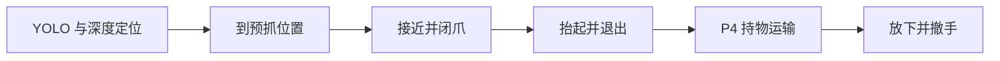

# P5 抓放实现方案：快速执行版

更新：2026-09-07。代码仓：`D:\DG\supermarket_sorting`。适用：DG-202606 智慧零售，MMK2，官方 Server/Client。

**本版按用户反馈简化设计，作为后续 agent 的当前实现依据。** 主线采用 YOLO 加深度定位、标定动作模板、三个关键确认点。上一版的逐物体完整形状拟合、多候选联合搜索、逐阶段固定等待不再是第一版必做项。

2026-09-07 代码已按本文落到 `runtime/p5_*.py`、`orchestrator.py`、`ros_sensor_utils.py`、`p4_nav.py`。单测覆盖两帧锁定、旧帧拒绝、坐标旋转、长 dt 暂停、抓空、持物失败不丢单、放置未确认不能下一单。完整可乐取送仍须在官方仿真里看碰撞、摩擦和裁判，不能只看 unittest。

背景：[AGENTS.md](./AGENTS.md)、[AGENT-BRIEF](./DG-202606-AGENT-BRIEF.md)。物体尺寸和现有问题：[P5 抓放设计讨论](./DG-202606-P5-抓放设计讨论.md)。导航沿用 [P4 HANDOFF](./DG-202606-P4-AGENT-HANDOFF.md) 的现有实现。

## 1. 目标与主流程

目标是让正常抓取连续执行，减少推理阻塞、重复观察和无意义的停顿。先做可乐完整取送，再开放其它商品。提速是否有效，以完整循环的成功率和仿真耗时判断，不能只看闭爪动作快了多少。



只保留三个需要物理证据的业务确认点：

| 确认点 | 确认什么 | 如何避免额外耗时 |
| --- | --- | --- |
| C1，抓取前 | 是当前目标，三维位置可信，当前模板能抓 | 正常取两帧新鲜观测，第二帧合格就继续，不再强制等五帧或固定一秒 |
| C2，抬起退出过程中 | 物体确实随夹爪移动，已经搬离且可运输 | 将观察安排在必要的抬升、短程退出和收臂过程中，正常情况不单独停下试提后再抬第二次 |
| C3，松爪之后 | 商品留在桌面、与手分离并稳定 | 观察与撤手重叠，满足稳定条件即结束，不等“撤手完成后再固定等一秒” |

关节到位、传感器新鲜度、障碍、超时和急停仍随控制周期检查。这些检查不单独增加等待状态。闭爪后建立夹持、底盘刹停和物体落座需要真实时间，不能把它们全部删除。

## 2. 本次具体简化什么

| 项目 | 快速版默认做法 | 何时再增加复杂度 |
| --- | --- | --- |
| 识别 | 本地 YOLO，按订单 `kind` 过滤 | 九类权重交付后扩类别，不更换识别框架 |
| 三维定位 | bbox 主体区域的小块深度中值、相机投影、尺寸补偿 | 观测持续不稳定时扩大 ROI 深度筛选；特殊形状再研究拟合 |
| 多帧处理 | 同一件商品的两帧一致性检查 | 两帧冲突时补第三帧；仍冲突则重观测 |
| 实例关联 | 已选 bbox、三维距离、可选槽位进行局部关联 | 第一版不实现通用多目标跟踪系统 |
| 货架/桌面 | 一次校准的固定结构几何，每次做局部深度一致性检查 | 结构观测明显不符时才补观察或拟合 |
| 抓取动作 | 按商品和层高读取已标定模板，平移/旋转到实测目标 | 当前模板不可用时做一次有限修正；不每次搜索全部站位、slide 和抓姿 |
| 运动学 | 复用 KDL，当前姿态作 seed，生成一次本次路径 | 目标或底盘发生计划外变化时重算 |
| 碰撞检查 | 标定模板的整段运动范围，运行时检查是否仍在适用范围及有无新增障碍 | 第一版不新增通用全身碰撞规划器 |
| 状态切换 | 条件满足立即切换，同一条连续轨迹的中间点不重复刹停 | 真正接触动作和异常才要求停止或稳定 |
| 失败恢复 | 同一订单最多一次重试，失败仍保留现场 | 不在每个子步骤各自嵌套三次重试 |

模板不是固定商品世界坐标。它保存相对抓取姿态、行程和适用范围；每件商品的位置仍由 YOLO 和深度得到。没有模板的类别/姿态明确报告暂不支持，不临时套用可乐参数。

## 3. YOLO 加深度的简化定位

### 3.1 一次定位怎样完成

1. 使用当前 `kind` 的 YOLO 检测框。`id` 只用于订单记账，不解析 ID 后缀查询商品或槽位坐标。ArUco 只辅助认槽和扫视，不能替代商品 XYZ。
2. 在 bbox 主体内部选中心小块，初值 9×9 像素；边界收在框内，剔除零值、NaN 和明显离群深度。用有效值中值，避免只取单个像素。
3. 中心块无效或明显混入背景时，在同一帧检查附近少量小块，按深度一致性、位置和模板尺寸选可信块。不能把货架背景深度直接当成商品距离；还不确定才补拍。
4. 用选中块对应的像素位置和深度反投影三维点，经头相机外参和底盘位姿换算到统一参考系。
5. 根据 `kind` 的已知尺寸、固定抓取朝向及标定偏差，从可见表面估计夹持位置。
6. 选定一件后只关联它，下一帧不得重新随意选择最居中的同类商品。两帧位置差和模板误差预算均合格就完成 C1。

普通 YOLO 给出类别和二维框，距离来自 aligned depth。NumPy/OpenCV 分别负责数值换算和图像处理，“离线模型”就是本地 YOLO，不是另一套识别方案。

简化估计器先只覆盖已标定的可乐视角。直立圆柱可沿相机到目标的水平观察方向补半径，可乐半径为 0.0265 m；Z 偏差另行标定。框中心不一定是几何中心，所以不能把这个补偿推广到任意遮挡、朝向和形状。

球类、圆台和楔包先保留对应配置位置，不要求为了可乐闭环先实现它们的拟合算法。增强方法只有经过验证后才可成为运行时回退；第一版找不到可信深度时停下来重观测即可。

### 3.2 必须保留的坐标关系

约定 `T_AB` 将 B 系坐标变换到 A 系。W 为与场景对齐的世界系，B 为底盘参考系，C 为 optical 相机系，E 为 KDL endpoint，G 为实际夹持中心。

```text
p_C = ((u-cx)*depth/fx, (v-cy)*depth/fy, depth)
p_W = T_WB(t_image) * T_BC(q_image) * p_C
T_WG_measured = T_WB(t_now) * FK(q_now, slide_now) * T_EG
T_BE_goal = inverse(T_WB(t_now)) * T_WG_goal * inverse(T_EG)
```

复用 [head_camera_kinematics.py](../runtime/head_camera_kinematics.py) 和 `MMK2KdlBackend`。核对 base_link/footprint/KDL 原点差异，`T_EG` 一次标定后复用。物体中心、夹持中心和 endpoint 不混为一个点。`T_EG` 仍为 I 时，可乐模板用 `creep_stop_along=-0.035` 让夹爪包住罐身（对应旧 `CREEP_STOP_DY`）；指尖外参标定后再把包络量收进 `T_EG`，不要叠两段。

接近方向 `a_W` 来自模板与本次货架站位，进入抓取前固定：

```text
p_WG_pre = p_WG_goal - d_pre * a_W
forward_error = dot(p_WG_goal - p_WG_measured, a_W)
```

用实际误差/行程结束进给和退出，不写死世界 Y。位置和姿态都转换到实时底盘系。

### 3.3 静止锁定，减少同步复杂度

头部和升降的主要调整在最终锁定前完成。默认在底盘、头部、升降停稳后取 C1 的两帧；预览或导航中的识别可以提前找候选，但不能直接作为精抓结果。

保留 RGB-D、odom 和关节时间戳及少量历史，使用图像时刻附近的位姿。RGB-D 差值初值不超过 0.05 s；运动造成的位置误差还需满足模板预算。不能把同一缓存图重复推理算成两帧，不能将移动后的相机外参用于旧图。

正常锁定后，伸臂不改变相机安装姿态，可以复用当前目标。若重新移动底盘/slide、目标被碰动或观测超出适用范围，则清除锁定并重观测；模板内已计划的进给和抬升使用世界系锁定与实时坐标转换，不因此每走一步就重锁。持物观测仍须做时间对齐，不能为了省一次同步误判抓空或成功。

## 4. 把调参留在标定阶段，把执行留给模板

每个 `GraspRecipe` 保存以下最小配置：

| 配置 | 内容 |
| --- | --- |
| 适用条件 | kind、层高/高度范围、允许观察方向、目标前向/横向范围、误差上限 |
| 几何 | 商品尺寸、夹持位置修正、夹持姿态、`T_EG`、手指和掌座间隙 |
| 动作 | 首选 slide、预抓退让、进给方式/最大行程、闭合指令、抬升/退出、持物姿态 |
| 时间与限制 | 各段速度/加速度、必要的接触稳定窗口、超时、配置版本与是否开放 |

第一项可乐优先复用现有“展开手臂、底盘短程进给、闭爪、升降抬起、后退”的执行结构。旧参数用于标定起点：`slide=0.11`、`close=0.08`、进给速度 0.06 m/s；它们不是所有层高、方向和商品的通用参数。

每个模板固定一种进给方式。将来验证了手臂直线进给更合适，可以给对应模板选该方式；正常抓取不执行“手臂方案失败再搜索底盘方案”的通用分支，也不在插入货架后临时切换。

模板开放前在仿真检查整段轨迹、实际开口、邻物/货架/两臂间隙和运输姿态。运行时只需确认当前条件仍在已验证范围，对本次变换后的路径解 IK、FK 回算和检查限位。关节解需要连续，中间路径点的实际运动也必须在模板范围内；几个终点可达不能代替整段可行。

当前模板不适用时，最多做一次有限站位或 slide 修正并重新定位；仍不适用就返回失败或顺延订单，不做穷举搜索。底盘没有侧移能力，站位调整通过现有导航接口完成。

三个机械边界仍然有效：

- `slide ∈ [-0.04,0.87]`，值减小表示上升；变化会影响双臂和头相机。不能为了省步骤在狭窄架内大幅改变升降。
- G2 最大开口约 80 mm，夹爪指令为 0–1，不是米或力。实际开度反馈含义与闭合保持需要标定。
- 掌座宽约 160 mm，指尖能进入不代表手掌能进入；底盘短程进给同样需要前方和后退通道检查。

P5 近距进给不能直接套 P4 的 `STOP_DIST=0.43`，但也不能关闭雷达。使用标定的底盘轮廓、货架物理边界、实际允许行程和刹停余量检查；新增障碍仍停车。近距保护或模板尚未验证时，不开放该动作。

## 5. 六个业务阶段怎样连续执行

保留现有 `GraspSession` 的实现基础。可以保留 `close/lift/retreat` 等内部子步骤用于控制和日志；不必为了让状态数看起来少而重写枚举。关键是子步骤之间没有重复计时等待。

| 业务阶段 | 执行内容 | 完成条件 |
| --- | --- | --- |
| `LOCATE` | 调整观察姿态、两帧 YOLO/深度定位、选择模板和生成本次路径 | C1 合格，实际数据和 IK 在模板范围内 |
| `PREGRASP` | 从实测关节出发，张爪并移动到预抓位；模板允许的动作可以同时进行 | 张爪、姿态和位置都到位；不额外叠加固定 dwell |
| `GRASP` | 按模板受限进给，到夹持位停稳后缓变闭爪 | 闭合命令已实际推进到目标，经过必要接触稳定；不直接宣布成功 |
| `LIFT_RETREAT` | 一次连续抬起、退出、收至持物姿态，同时进行 C2 观察 | 物体跟随、搬离量和运输姿态都合格，才向编排报告抓取成功 |
| `DELIVER` | P4 导航，持续保持关节/夹紧命令，异步监测物体 | 到配送接近点并停稳；若有持物疑点先恢复确认 |
| `PLACE` | 到空位上方、降低、松爪、撤手，观察完成 C3 | 商品与手分离、在桌上且稳定，才能结束当前循环 |

`RECOVER/PAUSED/FAILED/DONE` 是异常或终止出口，不增加正常路径的停顿。所有阶段超时可按 `2 × 计划时长 + 1 s` 起步，再受全局剩余预算约束；到期是失败出口，不是“时间到了算动作完成”。

### C1：两帧可靠就抓

两帧须属于同一物体、深度有效且位置变化满足该类误差预算。误差预算同时覆盖视觉偏差、外参、FK 和运动跟踪，不能只看两帧抖动很小。

```text
object_width + 2 * (lateral_error_bound + entry_margin) <= actual_open_gap
```

可乐约 53 mm，余量比橙子大。橙子约 74 mm，在 80 mm 开口里仅剩 3 mm/侧，不能沿用可乐容差。深度冲突才取第三帧；第三帧仍不支持可靠位置则重观测，不无限攒帧。

### C2：在抬升和退出时确认，不增加一套重复动作

一次抬升先离板约 0.015–0.025 m；若该模板需要更高的离板高度且上方允许，就在同一段轨迹继续抬升。不得无条件套用旧 0.05 m，也不先试提后放下再重抬。

用两帧独立的新观察检查物体实际位置与实测夹持中心一起变化。可通过预测的头相机 ROI 寻找同一件商品，但证据必须来自真实图像/深度，不能用 FK 假定物体挂在手上后自证成功。此时取消“物体仍在原货架支撑面”的定位约束。

必要的短程退出可与观察重叠，但只走模板内有间隙、可停下的路径。C2 未确认时保持 `UNKNOWN`，不开始底盘转向或长距离运输；观察结束边界仍看不清就保持夹紧、停下重看。闭合数值和原货位空了都不能单独证明抓住。

手掌和物体完全离架后才能折臂/转向。后退需要后方 scan 有效；搬离按物体抓前、抓后水平位置差计算，下界须达到 0.20 m，不能用倒车距离或固定世界 Y 代替。临时 FK 预测只能辅助，运输前应有独立视觉证据。

### C3：撤手和稳定观察重叠

放置后检查商品确实在桌上、与夹爪分离并位于 `delivery_box`。本地稳定初值为连续约 1 s 仿真时间内速度低于 0.02 m/s；稳定窗口可以从松爪后可见时开始，覆盖撤手时间。

手在移动时用时间对齐后的世界坐标判断物体是否移动。发生遮挡就等有效观测，不把“没有看见运动”当成静止；撤手推到物体后重新累计稳定证据。可观测姿态的商品兼顾直立，球类检查滚动而不虚报自转角。

## 6. 优先解决真正拖慢动作的地方

### 6.1 识别和控制分开

现 `p5_preview._run_session()` 每轮先做 CPU YOLO，再 `session.tick()` 和发布命令；而状态机按固定 `1/30` 推进插值。推理慢时，动作推进和命令发布也可能一起变慢。应先测量并解决这一点。

- YOLO 模型只加载一次，继续用 CPU，避免与 Server GS 抢 4060 显存。
- 一个感知工作线程按需处理最新图像，待处理队列最多保留一张；未换帧不重复推理，过时结果不更新目标。
- 控制循环目标约 30 Hz，不等待 YOLO、文件写入或耗时规划。控制实际频率需记录。
- C1、C2、C3 优先请求感知；普通关节移动期间不强制逐 tick 做 YOLO。运输异步监测，不每个转弯都强制停车重识别。
- 轨迹推进使用实际仿真 `dt`。若控制间隔异常过大，先停车/重采样，不一次跳过大量路径点；不能简单放大步长造成动作突跳。

### 6.2 到位即继续，避免反复等稳

删除“关节已经到位，但还要再等完整固定时间”的重复等待。位置/姿态收敛证据可在动作末尾累计，跨到下一阶段时不用清零后再等一次。同一条已检查轨迹的中间点使用连续跟随，不逐点停车。

实际闭合命令经过 slew 到达目标后，仍需短暂建立夹持；先保留旧 0.80 s 作为标定上限参考，测量可靠接触所需时间后再缩短。夹物时反馈开度可能被物体阻挡，不能要求它必须等于闭合指令才继续。

底盘停稳后才闭爪；可靠建立夹持后才抬升。外层停止应立即输出零底盘命令，不受普通平滑斜坡延迟。保持的是已验证的夹紧目标，不是把受阻反馈开度重新作为松弛后的目标。

### 6.3 自由空间和接触区分速

先通过前两项提速，再调整机械运动速度。手臂在已验证的自由空间可使用正常速度，最后接近商品/桌面的短段降速；抬升到足够离板高度后直接退出，不多走一段无用高度。

缩短预抓退让和后退距离前，先验证指尖、掌座、刹停与货架前沿余量。不能单纯把旧 0.220 m 改小并假定不会碰撞。

## 7. 运输和放置保留必要的几何逻辑

持物时继续使用 P4 栅格/A* 和本局地图，保持唯一底盘指令来源。正式入口持续发布两臂/升降和夹紧目标，P4 的扫视 slide 命令不能覆盖持物姿态。

当前 P4 默认可到 2.40 m/s，不作为持物默认速度。带载先使用已验证的低速配置，原建议 0.20 m/s 线速、0.35 rad/s 角速仅作为联调起点；通过滑移、转弯、制动测试后再逐级提高。抓取提速和运输提速分别量化。

运输中没有异常证据时继续执行，视觉监测异步进行。反馈异常、疑似滑移或观测超出标定的遮挡时限才触发停车确认；无接触力或无有效视觉的情况下，不能无限期假定仍然持物。

配送底盘目标为 `(-1.94,-2.90)` 朝南，必须 P4 `arrived` 并停稳。`(-1.94,-3.41,0.807)` 是桌附近参考 site，不直接等同于桌面高度、物体中心或 endpoint。

第一版使用少量已校准、可支撑且在裁判区域内的桌面候选位置，按顺序选择未占用者。结合本局放置记录和当前深度检查，防止第二件叠到第一件上；不必每次做桌面点云重建。

放置高度由真实桌面支撑高度和抓持关系计算。对直立物体，模板保存夹持中心 G 到物体底面的高度 `h_bottom_from_G`：

```text
z_G_release = z_table_support + h_bottom_from_G + release_clearance
T_WE_release = T_WG_release * inverse(T_EG)
```

释放间隙初值 3–5 mm，需覆盖定位误差且避免穿桌/高落差。物体姿态变化或握持位置滑移时该模板值失效，必须重新确认。不能所有商品都用旧 `PLACE_LOWER_Z=0.85`。

先快速到空位上方，最后一小段慢降，静止松爪，沿检查过的通道撤手并完成 C3。没有力传感器时不使用向下压桌寻找接触。

记录 `place_sequence_done`、`place_verified_local` 和独立的 `referee_confirmed`；未取得裁判证据时最后一项为 `null`。裁判的 0.30 m 掉落阈值、倾倒和稳定判定仍需核对完整语义，尤其 L3 正常放桌也可能下降超过 0.30 m；不能自行认定慢降就不罚分。

## 8. 九类扩展与失败处理

九类共享上述流程，差别放在模板。只有识别权重和动作模板均可用的类别才开放。

| kind | 外形/关键宽度 | 快速版安排 |
| --- | --- | --- |
| `kele` | 圆柱 D=53 mm，H=145 mm | 第一项；主体深度加已标定位置修正，完成真实取送 |
| `kouxiangtang` | 圆柱 D=49 mm，H=80 mm | 后续复用，检查矮物体指垫与隔板间隙 |
| `shupian` | 圆柱 D=65 mm，H=210 mm | 后续复用，单独标定轻物体的闭合/进给 |
| `maidong` | 圆柱 D=65 mm，H=210 mm | 后续复用；0.643 kg 需要单独验证保持与运输 |
| `pingguo` / `chengzi` | 球 D=70/74 mm | 误差预算更紧，必要时再增加球心估计，低落差放置防滚 |
| `sanmingzhi` | 楔包约 65×100×99 mm | 只有薄边朝向明确且模板已验证才开放 |
| `heweidao` | 圆台，底 D=65 mm、顶 D=95 mm、H=105 mm | 需要单独验证下部夹持；检查整块指垫覆盖处最大直径 |
| `zhijin` | 盒 172×85×88 mm | 三边均超过 80 mm 开口，默认不做对心夹取；未完成订单保留 |

纸巾不能靠简单旋转把完整刚性盒的最小包络宽度降到 80 mm；圆台不能只凭底部 65 mm 就认定可夹。特殊接触实验不进入正常可乐流程。

只保留三值物体状态 `EMPTY/HELD/UNKNOWN`，继续由 `MissionOrchestrator` 管取一送一：

| 情况 | 处理 |
| --- | --- |
| 定位失败/模板不可用 | 不进给；最多一次局部修正和重新定位，仍失败则记录原因 |
| 确认抓空 | 按已验证路径退出，在空手且无接触危险时重试一次 |
| 可能持物但看不清 | 保持夹紧，暂停观察；`UNKNOWN` 不允许开始下一件 |
| 运送受阻但还持物 | 保留当前 `DELIVERING` 循环，恢复导航，不能调用旧 `complete_deliver(False)` 清除 holding |
| 确认掉落 | 停车，记录现场；确认空手后才能结束失败尝试，第一版不保证地面重抓 |
| 放置未确认 | 静止观察桌面和夹爪，不盲目重复开闭爪，不开始下一单 |
| 数据停更/越限/控制异常/总超时 | 立即零底盘命令，停止路径推进，保留必要夹紧与保持 |

一个订单最多两次实际闭爪，修正和重观测共用预算，不逐阶段重置计数。订单失败保持 pending；确认空手后可顺延其它可执行订单，全部不可执行时有原因地退出/暂停，不能报全部完成。同一 `run_prefix` 的任务重发不能重置记录、计时或当前循环。

## 9. 速度目标、计时和验收

**可乐单次正常抓取暂以 10–15 s 仿真时间为优化目标，不是已测结果。** 统计从货架接近点停稳到持物退出并可导航，包含本次定位、必要姿态调整和 C1/C2，排除货架间与配送导航。失败、重试和重新站位单独记录，并计入整局总耗时，不能隐藏。

10–15 s 需要动作模板已经可行，实际下限受关节路径、进给/退出距离和接触时间限制。例如旧 0.220 m 进给若全程以 0.06 m/s 执行，仅这一段就约 3.7 s。先测各段占时，再决定优化动作距离还是推理/等待；不能靠调小超时达到目标。

比赛总预算为 420 s 仿真时间，使用 `/clock` 或核实后的 MuJoCo 时间戳，并与 Server 比赛起点对齐；墙钟只用于通信/执行看门狗。仿真暂停不推进动作，中途接入不能重新获得 420 s。

开始下一件前检查是否足够完成“抓取 + 当前路径带载配送 + 放置 + 预留”，已持物优先送完。记录仿真时间和墙钟两套统计，旧 48.27 s 抓取日志是墙钟，不能直接作为同口径速度对照。

实现时记录以下最少指标：

- 每阶段 `elapsed_sim_s`、`elapsed_wall_s`；等待时间区分推理、到位、接触稳定和异常恢复。
- 推理耗时、处理帧数、控制 tick 间隔及最大间隔，避免推理阻塞被误认为“机械臂慢”。
- C1/C2/C3 证据、抓空/掉落/碰撞、一次成功率、包括失败的总耗时与成功循环数。
- 配置版本、订单/实例/槽位、目标与实测末端、实际搬离量、放置位置和裁判证据。

在相同工况与相同计时口径下对比，先稳定至少三次可乐完整取送，再讨论是否提高关节或底盘速度。更快但抓空率上升、整局送达更少，不算优化成功。同一局失败恢复不得重置 Server 或换种子。

## 10. 实现 agent 的最小任务清单

优先在现有文件中改，不为第一版新建通用感知/规划框架。

| 文件 | 第一版需要做的事 |
| --- | --- |
| [runtime/p5_params.py](../runtime/p5_params.py) | 可乐模板、适用范围、两帧阈值、必要稳定时间与速度参数 |
| [runtime/p5_grasp.py](../runtime/p5_grasp.py) | 复用子步骤，改相对方向/行程与真实 dt，去重复等待，融合抬升退出与 C2，保留立即停车 |
| [runtime/p5_preview.py](../runtime/p5_preview.py) | 一次加载 YOLO、最新帧工作线程、控制不阻塞、两帧定位和三个确认点的调用、分段耗时记录 |
| [runtime/ros_sensor_utils.py](../runtime/ros_sensor_utils.py) | 必要的关节时间戳/短历史、快照新鲜度和时钟数据；复用已有 odom 历史 |
| [runtime/orchestrator.py](../runtime/orchestrator.py) | 持物未知时禁取下一件、配送受阻时保留当前循环、任务重发幂等 |
| [runtime/ros_robot_control.py](../runtime/ros_robot_control.py) 与 P4 接口 | 持续带载保持、明确限速、唯一发布来源和本局地图复用 |
| 后续 `runtime/mission_client.py` / `scripts/run_mission.sh` | 接同一抓取逻辑与编排，不另写一套任务状态机；脚本 LF，ROS setup 后再 `set -u` |

定位辅助函数可以先保留在 P5 文件内；体量变大再拆分。第一版数据只需扩展 `LockedTarget` 的实例、时间戳、估计位置/质量，以及模板、物体状态和动作结果；不强制要求完整物体六维重建或通用 `PlacePlan` 系统。

按以下顺序实施，每步都可独立检查结果：

1. **标定和记录基线**：确认相机到夹爪坐标、可乐模板的开度/路径/近距保护，补仿真与墙钟分段计时，不改执行速度。
2. **先消除软件等待**：YOLO 与控制分离、两帧锁定、按真实 dt 推进、到位即继续；检查控制不被推理拖慢。
3. **连续抓取和三个确认点**：抬升/退出与 C2 重叠，松爪/撤手与 C3 重叠；抓空、过时图像和持物未知必须走正确出口。
4. **完整可乐取送**：验证带载导航、正确放置高度、裁判结果、至少两件顺序取送及桌面占用。通过后按第 8 节扩模板。

每次实现后执行 `python -m unittest discover -v`。针对两帧不串目标、旧帧拒绝、坐标旋转、实际 dt 及长 tick 暂停、抓空不报成功、持物失败不丢订单、放置不确定不能进下一单补测试。单测不代替官方仿真的碰撞、摩擦和速度验收。

不改 `client_task_1.py`，不引入 Nav2/DWA/文旅 hug，不修改 A 线训练类别顺序或升级 ultralytics。`kele.pt` 继续只用于可乐；九类模型必须与交付 `data.yaml` 和 `KNOWN_KINDS` 一致。
